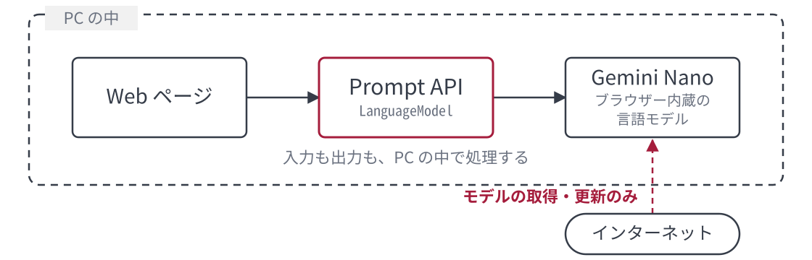
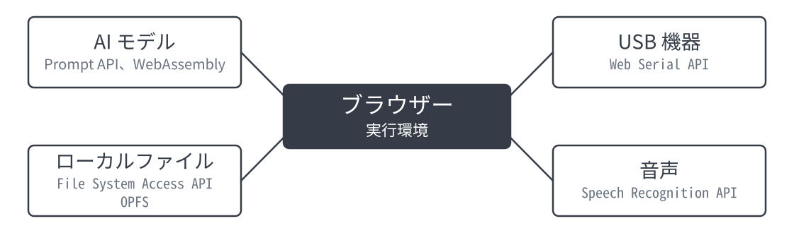
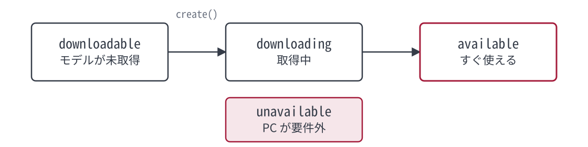
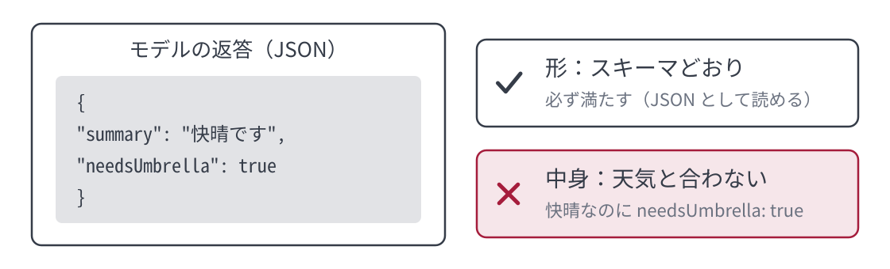
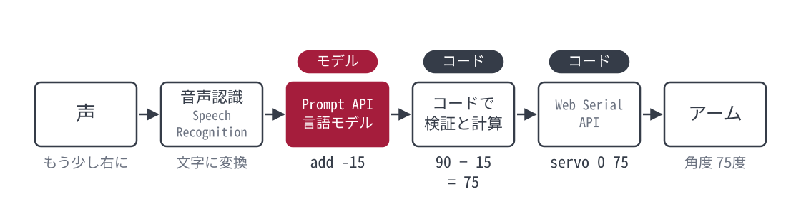
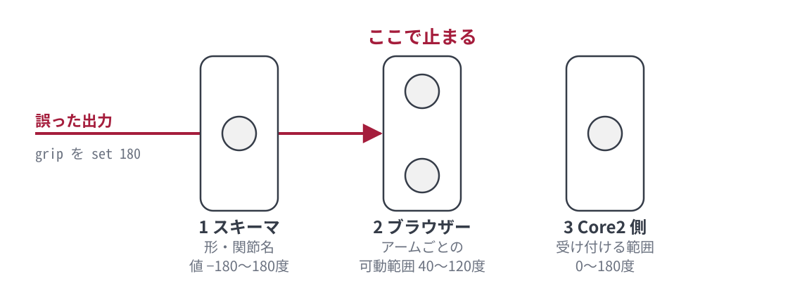

<!-- _class: cover seq -->
<!-- _paginate: false -->
<!-- _backgroundImage: url('assets/avatar-wave.jxl') -->
<!-- _backgroundSize: 210px -->
<!-- _backgroundPosition: right 70px bottom 30px -->
<!-- _backgroundRepeat: no-repeat -->


# 動かして学ぶ<br>Prompt API・Web Serial API

ブラウザーで AI を動かし、機器につなぐ

> WebDINO Japan 渡邉浩平

---

<!-- _class: chat late -->
<!-- _backgroundImage: url('assets/avatar-think.jxl') -->
<!-- _backgroundSize: 200px -->
<!-- _backgroundPosition: right 50px bottom 30px -->
<!-- _backgroundRepeat: no-repeat -->

# 機内モードの PC で

- 機内モード：**オン**　Wi-Fi：オフ
- この報告を短く要約して
- 試験は完了。温度の偏りを1件確認。再試験は来週。

サーバーも API キーもないのに、どこで動いている？

---

<!-- _class: seq -->

# 答えはブラウザーの中



通信するのはモデルの取得と更新だけ

> Prompt API は Chrome 148（2026年5月）で安定版になった

---

<!-- _class: map late-note -->

# この研修の見取り図

ブラウザーを、AI と機器とファイルをつなぐ実行環境として使う



> アプリを配布しなくても、Windows、macOS、Linux の Chrome で同じコードが動く

---

<!-- _class: cols seq late -->

# 2日間の流れ

### **Day 1**　PC だけ

- Prompt API の基本と JSON 出力
- WebAssembly で AI モデルを動かす
- ファイルへの保存
- 自分の業務の文章で小さなアプリを作る

### **Day 2**　M5Stack Core2 をつなぐ

- Web Serial API の基本
- センサー値を Prompt API に解説させる
- サーボモーターを動かす
- 声とセンサーでアームを動かす

どの演習も、*自分の PC で動かす*ところまで進める

> M5Stack Core2：センサーを内蔵した小型のマイコン機器。会場で配布する

---

<!-- _class: part -->
<!-- _backgroundImage: url('assets/avatar-point-left.jxl') -->
<!-- _backgroundSize: 260px -->
<!-- _backgroundPosition: right 90px center -->
<!-- _backgroundRepeat: no-repeat -->

PART 1

# ブラウザーに入っている AI

## Prompt API

---

# まず、使えるかを確かめる

```js
await LanguageModel.availability();
```



> Firefox と Safari には `LanguageModel` がなく、`ReferenceError` になる

---

# セッションを作って、聞く

```js
const session = await LanguageModel.create();
const answer = await session.prompt("日本語で自己紹介してください。");
output.textContent = answer;
session.destroy();
```

* モデルが未取得なら `create()` はダウンロードを伴う。クリックなどの操作から呼ぶ
* モデルの出力は信頼できない文字列。`textContent` で表示し、`innerHTML` には入れない
* 使い終えたら `destroy()` でメモリを返す

---

<!-- _class: stream -->

# 長い応答は、少しずつ表示する

```js
const stream = session.promptStreaming("日本の四季を一文ずつ紹介して");
for await (const chunk of stream) {
  output.textContent += chunk;
}
```

春は桜が咲き、夏は海で泳ぐ。秋は…

> `prompt()` は生成が終わるまで返らない

---

<!-- _class: flow seq -->

# 数値は、意味のあるラベルにしてから渡す

1. 気象 API
   - 天気コード 61
1. **コードで変換**
   - `61` → 「雨」
1. Prompt API
   - 「東京は雨、気温12度…」
1. やさしい説明文

小型モデルは、天気コードの割り当てを正確に覚えているとは限らない。

対応表で済む変換は、コードで済ませる。

---

<!-- _class: split seq -->

# 答えを JSON で受け取る

```js
const schema = {
  type: "object",
  properties: {
    summary: { type: "string" },
    needsUmbrella: { type: "boolean" },
  },
  required: ["summary", "needsUmbrella"],
};
const result = await session.prompt(text,
  { responseConstraint: schema });
const { needsUmbrella } = JSON.parse(result);
```

**返ってくるもの**
スキーマどおりの JSON 文字列

**使い道**
`if (needsUmbrella)` で分岐できる

**選択肢を限る**
`enum: ["なし", "小雨", "大雨"]`

---

<!-- _class: schema seq -->

# スキーマが保証するのは「形」まで



どこからをコードで確かめるかは、アプリを作る人が決める

---

<!-- _class: compare late-note -->

# モデルを持ち込む選択肢もある

|  | Prompt API | WebLLM（WebAssembly ＋ WebGPU） |
| --- | --- | --- |
| モデル | ブラウザーが用意（Gemini Nano） | 開発者が選ぶ（Qwen2.5-0.5B など） |
| 配布と更新 | ブラウザーが管理 | Web アプリがモデルの取得先と<br>ライブラリの版を指定 |

> どちらも入力文は PC の中で処理する。速さは PC と用途で変わるので、測って選ぶ

---

<!-- _class: part -->

PART 2

# ブラウザーから USB 機器へ

## Web Serial API

---

<!-- _class: flow -->

# 専用アプリなしで、機器とつながる

1. Web ページ
1. **Web Serial API**
   - バイト列の読み書き
1. USB シリアル
   - COM3、/dev/ttyUSB0
1. M5Stack Core2
   - センサー、サーボ

| ブラウザー | 対応 |
| --- | --- |
| Chrome、Edge | デスクトップ版 89 以降 |
| Firefox | 151 以降（2026年5月）。サイト権限アドオンが必要 |
| Safari | 非対応 |

---

<!-- _class: port -->

# ポートは利用者が選ぶ

```js
button.addEventListener("click", async () => {
  const port =
    await navigator.serial.requestPort();
  await port.open({ baudRate: 115200 });
});
```

* 選択画面はクリックなどの操作からしか開けない
* 許可したポートは、次から `getPorts()` で取れる
* `https://` か `http://localhost` のページで使う

1. **接続するシリアルポートを選択**
1. USB Serial (COM3)
1. Bluetooth 接続ポート (COM5)
1. `接続`

---

<!-- _class: wire punch -->

# 届くのは「断片」であって「行」ではない

- {"type":"sensor","acc
- el":[0.01,-0.02,0.99]}**\n**{"type":"but
- ton","name":"A"}**\n**

```js
buffer += decoder.decode(value, { stream: true });
const lines = buffer.split("\n");
buffer = lines.pop(); // 改行がまだ届いていない残り
for (const line of lines) handleLine(line);
```

改行までためてから、1行として扱う

---

<!-- _class: servo punch -->

# 送るときは、改行まで

```js
await writer.write(new TextEncoder().encode("servo 0 90\n"));
```

**servo 0 90**\n

チャンネル0（旋回）を90度に

改行がないと、Core2 はコマンドの続きを待ち続ける

---

<!-- _class: part -->
<!-- _backgroundImage: url('assets/avatar-idea.jxl') -->
<!-- _backgroundSize: 260px -->
<!-- _backgroundPosition: right 90px center -->
<!-- _backgroundRepeat: no-repeat -->

PART 3

# 声でアームを動かす

## 3つの API をつなぐ

---

<!-- _class: late -->

# 「もう少し右に」がアームに届くまで



モデルが返す JSON の `actions` の1要素

```json
{ "joint": "base", "change": "add", "value": -15 }
```

---

<!-- _class: cols seq late -->

# 言葉はモデルに、計算はコードに

### **モデル**：言葉を解釈する

「もう少し右に」→ 右に15度
「つかんで」→ グリッパーを閉じる

### **コード**：角度を計算する

現在90度 − 15 = 75度
現在の角度はコードが持ち、毎回プロンプトに書き込む

「75度」と直接答えさせると、小型モデルは*引き算を間違える*ことがある。

---

<!-- _class: layers punch -->

# 機器に送る前に、もう一度確かめる



どれか1か所に誤りがあっても、ほかの制限がアームを守る

---

<!-- _class: flow seq -->

# センサー値も、ラベルを付けてから渡す

1. Core2 の<br>センサー
1. **コードで集計**
   - 揺れ: 標準偏差0.044G
   - （小さな揺れ）
1. Prompt API
1. `level`
   - normal / warning / alert

0.044G が大きいかどうかを、小型モデルは知らない。

> スキーマではコメントを判定より先に置き、根拠を書かせてから判定させる

---

<!-- _class: where late -->

# どこまでが PC の中で動くか

| 処理 | どこで動くか |
| --- | --- |
| 音声の認識 | 日本語の言語パックがあれば PC 内、なければサーバー |
| 指示の解釈 | PC 内（Gemini Nano） |
| 検証と計算 | PC 内（JavaScript） |
| Core2 との通信 | PC 内（USB シリアル） |

ページとモデルを読み込んだ後なら、文字入力と PC 内で認識した声で、*オフラインでも*アームを動かせる

---

<!-- _class: cols prep seq -->
<!-- _backgroundImage: url('assets/avatar-laptop.jxl') -->
<!-- _backgroundSize: 170px -->
<!-- _backgroundPosition: right 40px top 40px -->
<!-- _backgroundRepeat: no-repeat -->

# 受講前の準備

### **Day 1 まで**

- Chrome 148 以降
- 空きストレージ22GB以上
- VRAM 4GB超、または RAM 16GB以上かつ CPU 4コア以上
- 「受講環境の事前確認」で Gemini Nano を取得
- WebLLM のサンプルでモデルを取得

### **Day 2 まで**

- Node.js の LTS 版（`npm start` 用）
- USB シリアル変換チップのドライバー（CP210x か CH9102）
- 教材リポジトリの取得

> WebLLM のモデルはオリジンごとに保存されるので、当日も取得したときと同じ開き方で開く。ドライバーは管理者権限が要ることがある
> 手順：kou029w.github.io/intro-to-web-dev/day1.html、day2.html の「受講前の準備」

---

<!-- _class: cover end seq -->
<!-- _paginate: false -->
<!-- _backgroundImage: url('assets/avatar-wave.jxl') -->
<!-- _backgroundSize: 210px -->
<!-- _backgroundPosition: right 70px bottom 30px -->
<!-- _backgroundRepeat: no-repeat -->


機内モードで返事をした AI に、

# 2日目は、アームを動かしてもらいます

> 1日目は、自分の PC で動かすところから始めます
> 教材：kou029w.github.io/intro-to-web-dev
