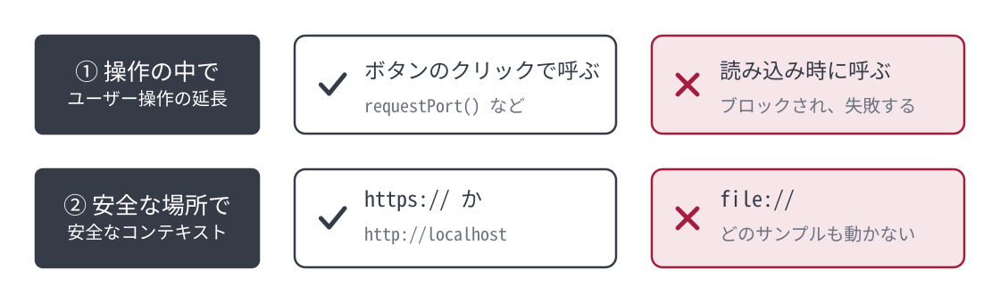
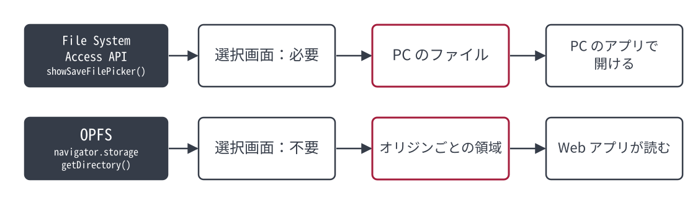

<!-- _class: cover seq -->
<!-- _paginate: false -->
<!-- _backgroundImage: url('assets/avatar-wave.jxl') -->
<!-- _backgroundSize: 210px -->
<!-- _backgroundPosition: right 70px bottom 30px -->
<!-- _backgroundRepeat: no-repeat -->


## Day 1

# AI プラットフォームとしての Web

コア技術編、ビルトイン AI（Prompt API）、サードパーティ AI（WebAssembly × AI）

> 2026年12月1日　10:00〜17:00

---

<!-- _class: day late-note -->

# 今日の時間割

| 時刻 | 内容 | 確かめること |
| --- | --- | --- |
| 10:00 | Web プラットフォームの今 | 2日間で使う API の全体像 |
| 10:30 | Prompt API 入門 | セッション、ストリーミング、構造化出力 |
| 11:25 | Prompt API サンプル集 | 入力、プロンプト、出力の対応 |
| 13:10 | WebAssembly で AI モデルを動かす | Wasm と WebGPU の役割 |
| 13:55 | File System Access API と OPFS | 保存先の違い |
| 14:40 | ミニチャレンジ | 業務の文章で小さなアプリを作る |
| 16:00 | 成果の共有 | 出力の確かめ方 |
| 16:40 | 振り返りと質疑 | Day 2 への準備 |

> 休憩 11:15、14:30、15:50（各10分）　昼休み 12:10〜13:10

---

<!-- _class: part -->
<!-- _backgroundImage: url('assets/avatar-point-left.jxl') -->
<!-- _backgroundSize: 260px -->
<!-- _backgroundPosition: right 90px center -->
<!-- _backgroundRepeat: no-repeat -->

PART 1

# コア技術編

## HTML、CSS、JavaScript、Web の「今」

---

<!-- _class: compare late-note -->

# 文書を見る道具から、アプリの実行環境へ

| 時期 | ブラウザーでできるようになったこと | 代表的な技術 |
| --- | --- | --- |
| 1990年代 | リンクでつながった文書を読む | HTML、CSS |
| 2000年代 | ページを読み込み直さずに画面を書き換える | Ajax（`XMLHttpRequest`） |
| 2010年代 | 動画、描画、オフライン動作、ホーム画面への追加 | HTML5、Service Worker |
| 2020年代 | GPU の演算、USB 機器、内蔵の AI モデル | WebGPU、Web Serial API、Prompt API |

> 新しい機能が加わっても、古いページは同じブラウザーで動き続ける

---

<!-- _class: cols seq -->

# 新しい機能を、いつから使えるか

### **Baseline**

- 主要ブラウザー（Chrome、Edge、Firefox、Safari）すべてで使える機能に付く印
- MDN や Can I use の各機能のページに表示される
- 2023年から

### **Interop**

- ブラウザー各社が、その年に互換性をそろえる分野を決めて取り組む
- 結果はテストの合格率で公開される
- 2021年から毎年

Prompt API と Web Serial API は、まだ Baseline ではない。対応するブラウザーを確かめてから使う

---

<!-- _class: compare late-note -->

# ライブラリの役割が、標準に移った

| かつての手段 | いまの標準 |
| --- | --- |
| jQuery の `$()` | `document.querySelector()` |
| モーダルのライブラリ | `<dialog>`、`popover` 属性 |
| ツールチップの位置の計算 | CSS Anchor Positioning |
| ページ遷移のアニメーション | View Transitions |
| Sass のネスト | CSS Nesting |
| Lodash の `groupBy`、`cloneDeep` | `Object.groupBy()`、`structuredClone()` |

> 標準に入った機能は、ライブラリの読み込みも更新も要らない。対応状況は Baseline で確かめる

---

<!-- _class: flow seq -->

# JavaScript の仕様は、毎年少しずつ決まる

1. Stage 1〜2
   - 課題と解き方の検討
1. Stage 2.7
   - 仕様文とテスト
1. **Stage 3**
   - ブラウザーが実装
1. Stage 4
   - 次の ECMAScript へ

TC39 が提案を段階的に進め、毎年6月に ECMAScript の新しい版が出る

> Stage 3 でも、実装して見つかった問題で仕様が変わることがある

---

<!-- _class: compare -->

# ES2022 から ES2025 で入った書き方

| 版 | 例 |
| --- | --- |
| ES2022 | トップレベルの `await`、`#` で始まるプライベートフィールド、`at()` |
| ES2023 | 元の配列を変えない `toSorted()`、`findLast()` |
| ES2024 | `Object.groupBy()`、`Promise.withResolvers()` |
| ES2025 | イテレーターヘルパー、`Set` の `union()` など、`Promise.try()`、JSON モジュール |

研修のサンプルも、トップレベルの `await` と `for await...of` を使っている

---

<!-- _class: compare late-note -->

# JSConf JP 2026 で話されていること

| 分野 | 話題の例 |
| --- | --- |
| 言語と仕様 | AsyncContext、`Math.sumPrecise()`、値の比較と同一性 |
| ブラウザーの機能 | HTML-in-Canvas、Canvas 2D の拡張、FedCM、JPEG XL、`ariaNotify()` |
| AI | エージェントが書くコード、生成 UI、WebMCP と Chrome の内蔵 AI |
| 実行環境 | WasmGC、単一バイナリ化、V8 の最適化 |
| セキュリティ | npm のサプライチェーン攻撃 |

> AI の話題は、「AI でコードを書く」と「Web で AI を動かす」の両方がある。この研修は後者を扱う

---

<!-- _class: seq late-note -->

# 書くのは HTML と JavaScript だけ

- AI モデル、USB 機器、ファイル、Wasm の計算を、同じ JavaScript から呼ぶ
- API はどれもブラウザーに最初から入っている
- API のために OS に入れるのは、Core2 の USB シリアル変換チップ用のドライバーだけ

> Node.js と `npm install` は、サンプルを `http://localhost` で配信するためのもの

---

<!-- _class: seq punch -->

# 開いただけのサイトに、機器を触らせない



ポートやファイルを選ぶのは利用者。ページの読み込み時に呼ぶと失敗する

動かないときに、最初に疑う2か所

---

<!-- _class: split -->

# 応答も受信も、同じストリーム

```js
// Prompt API
const stream =
  session.promptStreaming(text);
for await (const chunk of stream) {
  output.textContent += chunk;
}

// Web Serial API
const reader =
  port.readable.getReader();
const { value, done } =
  await reader.read();
```

**`promptStreaming()` の戻り値**
`ReadableStream`

**`port.readable`**
これも `ReadableStream`

**共通点**
届いた分から順に処理する

---

<!-- _class: part -->

PART 2

# ビルトイン AI

## Prompt API

---

<!-- _class: compare late-note -->

# Web から AI を使う3つの形

|  | クラウドの API | サードパーティ AI | ビルトイン AI |
| --- | --- | --- | --- |
| 呼び方 | `fetch()` | WebAssembly ＋ WebGPU | Prompt API |
| モデル | サーバー上の大型モデル | 開発者が選んで配る | ブラウザーが用意する |
| 入力の行き先 | サーバー | 端末の中 | 端末の中 |
| 費用 | API の従量課金 | 配信の費用だけ | 配信の費用だけ |

> 午前はビルトイン AI、午後はサードパーティ AI を動かす

---

<!-- _class: cols seq -->

# 端末の中で AI を動かす得失

### **得るもの**

- 入力文が端末の外に出ない
- API キーも、呼び出しごとの課金もない
- モデルを取得した後は、通信なしで動く
- サーバーとの往復を待たない

### **引き受けるもの**

- モデルが小さく、知識も計算も間違えやすい
- PC に空きストレージと GPU かメモリが要る
- ブラウザーごとに、使えるモデルが違う

小さいモデルの弱点は、渡す前と受け取った後のコードで補う。今日の演習はその練習でもある

---

<!-- _class: compare late-note -->

# ブラウザーが AI を標準で備え始めた

| API | 役割 | 状況 |
| --- | --- | --- |
| Translator API、Language Detector API | 翻訳、言語の判定 | Chrome 138 で安定版（2025年） |
| Summarizer API | 要約 | Chrome 138 で安定版（2025年） |
| Prompt API | 汎用のプロンプト、画像と音声の入力 | Chrome 148 で安定版（2026年） |

API の形は標準として議論し、どのモデルで動かすかはブラウザーが決める。Microsoft Edge は、同じ Prompt API を Phi-4-mini で試験実装した

> 用途の決まった API で足りるなら、そちらを使う。今日は汎用の Prompt API を扱う

---

<!-- _class: demos late-note -->

# 動かすサンプルと、確かめること

| サンプル | 確かめること |
| --- | --- |
| プレイグラウンド | システムプロンプトを変えると、応答がどう変わるか |
| 類義語検索 | 並べた例の形と、応答の形が一致するか |
| 画像を説明してもらう | 写っているものと、説明の対応 |
| 音声を文字起こしする | 話した内容と、文字起こしの対応 |
| 書き起こしのフィラー除去 | 1段目の文字起こしと、2段目の文の対応 |

> どのサンプルでも、入力、プロンプト、出力の3つを並べて見る

---

<!-- _class: split -->

# 画像も音声も、そのまま渡す

```js
const session = await LanguageModel.create({
  expectedInputs: [
    { type: "text" }, { type: "image" },
  ],
});
session.promptStreaming([{
  role: "user",
  content: [
    { type: "text", value: promptEl.value },
    { type: "image", value: file },
  ],
}]);
```

**画像**
ファイル選択で得た `File`

**音声**
`type: "audio"` に、録音した `Blob` の `arrayBuffer()`

**先に宣言する**
使う入力の種類を `expectedInputs` に書く

---

<!-- _class: split -->

# 例を並べて、答えの形を示す

```js
LanguageModel.create({ initialPrompts: [
  { role: "system",
    content: "あなたは日本語の類語辞典です…" },
  { role: "user",
    content: "「面白い」の類義語を挙げて…" },
  { role: "assistant",
    content: "- 愉快\n- 楽しい\n- 興味深い…" },
]});
```

**n-shot プロンプティング**
入力と出力の例を先に見せる

**`clone()`**
例を読ませたセッションを複製して、検索のたびに使う

---

<!-- _class: swap late-note -->

# 要約も翻訳も、プレイグラウンドで

| システムプロンプト | 試せること |
| --- | --- |
| 入力文を3行に要約してください。 | 要約 |
| 入力文を英語に翻訳してください。 | 翻訳 |

> JSON Schema の欄に書くと、同じ画面で構造化出力も試せる

---

<!-- _class: part -->
<!-- _backgroundImage: url('assets/avatar-think.jxl') -->
<!-- _backgroundSize: 250px -->
<!-- _backgroundPosition: right 90px center -->
<!-- _backgroundRepeat: no-repeat -->

PART 3

# サードパーティ AI

## WebAssembly × AI

---

<!-- _class: cols seq -->

# WebAssembly が生まれた理由

### **背景**

- JavaScript だけでは、重い計算を速く動かしにくかった
- C、C++、Rust で書かれた計算の資産は、ブラウザーの外にあった

### **答え**

- コンパイルした命令を、ブラウザーが安全に実行する形式
- 2017年に主要4ブラウザーがそろって対応
- 画像編集や地図、CAD の Web 版も Wasm で動いている

AI の推論ランタイムも、この流れでブラウザーに入ってきた

---

<!-- _class: flow seq -->

# Wasm は CPU 側、WebGPU は GPU 側

1. JavaScript
   - 画面と入力
1. **Wasm**
   - 推論ランタイム
1. WebGPU
   - モデルの演算

WebLLM はこの3つを組み合わせる。GPU には WebGPU を通して届く

> 「Wasm にすれば JavaScript より必ず速い」わけではない。利点は、既存の計算ライブラリと最適化を持ち込めること

---

<!-- _class: compare libs -->

# ブラウザーで使う推論ライブラリ

| ライブラリ | モデルの形式 | 渡すもの、受け取るもの |
| --- | --- | --- |
| ONNX Runtime Web | ONNX | 数値配列（テンソル） |
| LiteRT.js | LiteRT（`.tflite`） | 数値配列（テンソル） |
| WebLLM | MLC | 会話のメッセージと、生成した文章 |

ONNX Runtime Web と LiteRT.js は、どちらも CPU（Wasm）か GPU（WebGPU など）で動く。モデルの形式と対応する演算で選ぶ

演習では WebLLM で Qwen2.5-0.5B に要約させる

---

<!-- _class: cols seq -->

# Wasm の新しい機能

### **WebAssembly 3.0**

- Memory64：4GiB までだった線形メモリのアドレス空間を広げる
- 1つのモジュールで複数のメモリを扱える
- 2025年9月に仕様の完成を発表

### **JSPI**

- Promise を返す JavaScript の関数を、Wasm から同期的に呼ぶ
- 解決するまで Wasm の実行を止めて待つ
- 標準化済み。Chrome 137 以降

---

<!-- _class: compare late-note -->

# ビルトインか、サードパーティか

|  | ビルトイン AI | サードパーティ AI |
| --- | --- | --- |
| モデルを選ぶ | できない（ブラウザーが決める） | できる（用途に合うモデルを選ぶ） |
| 初回の取得 | ブラウザーが1回取得し、サイト間で共有 | サイトごとに取得し、オリジンごとに保存 |
| 対応ブラウザー | Chrome（ほかは対応待ち） | WebGPU のあるブラウザー |
| 版の固定 | ブラウザーの更新で変わる | 開発者が固定できる |

> 速さと答えの質は、PC と用途で変わる。同じ入力で両方を試し、測って選ぶ

---

<!-- _class: part -->

PART 4

# 記録を保存する

## File System Access API と OPFS

---

<!-- _class: punch -->

# 保存先は、利用者が選ぶか、アプリが持つか


`localhost:3000` と `localhost:3001` は別のオリジン。同じ URL で開き直す

持ち帰る記録は、選んだファイルにも保存する

---

<!-- _class: part -->
<!-- _backgroundImage: url('assets/avatar-laptop.jxl') -->
<!-- _backgroundSize: 260px -->
<!-- _backgroundPosition: right 90px center -->
<!-- _backgroundRepeat: no-repeat -->

PART 5

# ミニチャレンジ

## 業務の文章を処理する小さなアプリ

---

<!-- _class: cols seq -->

# モデルの差より、現場の課題

### **モデル**は入れ替わる

- 汎用の言語モデルは、年ごとに性能が上がり、差は縮まる
- 今日使ったモデルも、来年には別のものになっている

### **課題と画面**は残る

- 何を入力し、何を返させれば仕事が減るか
- 出力をどう確かめれば、現場で使えるか

お題は、自分が毎週繰り返している作業から選ぶ

---

<!-- _class: tasks -->

# お題の例

| お題 | 出発点 | 返させる形 |
| --- | --- | --- |
| 試験記録の所見を1文に要約 | プレイグラウンド | `summary` |
| 不具合報告を重大度で分類 | プレイグラウンド | `severity`、`reason` |
| 問い合わせを担当部署に振り分け | 類義語検索 | `department` |
| 記録から日付と数値を抜き出す | プレイグラウンド | `items` |
| 口頭の報告を書き言葉に言い換え | フィラー除去 | `replaced` |

手が止まったら、毎週のように繰り返している作業を思い出す

---

<!-- _class: seq -->

# 70分の進め方


読みやすい要約にも、元の文章にない数値が混ざることがある

> LiveCodes や StackBlitz ではファイル選択画面を開けないので、記録は OPFS に保存する

---

<!-- _class: share seq -->
<!-- _backgroundImage: url('assets/avatar-idea.jxl') -->
<!-- _backgroundSize: 220px -->
<!-- _backgroundPosition: right 80px top 150px -->
<!-- _backgroundRepeat: no-repeat -->

# 成果の共有で話すこと

1人2分程度

1. 何を入力し、モデルに何を返させたか
1. モデルの出力が正しいかを、*どう確かめたか*

> 業務の文章を使うときは、社内規程に従う。外部の API を呼ぶサンプルでは、渡した値が通信先に送られる

---

<!-- _class: cover end seq -->
<!-- _paginate: false -->
<!-- _backgroundImage: url('assets/avatar-wave.jxl') -->
<!-- _backgroundSize: 210px -->
<!-- _backgroundPosition: right 70px bottom 30px -->
<!-- _backgroundRepeat: no-repeat -->


今日はモデルの出力を、コードで確かめた

# 明日は、その出力で<br>機器を動かします

> Day 2 は M5Stack Core2 を USB でつなぐ
> Node.js、ドライバー、教材リポジトリを用意しておく
