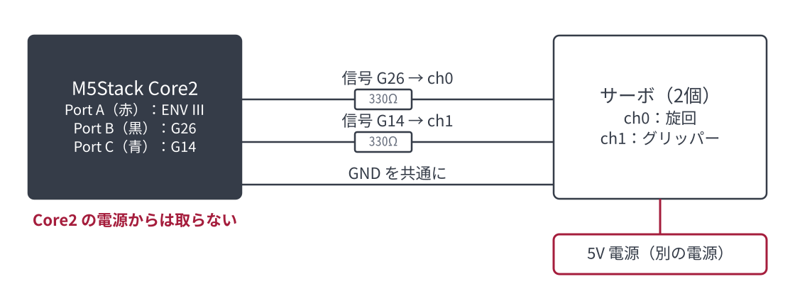
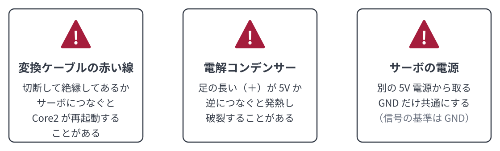
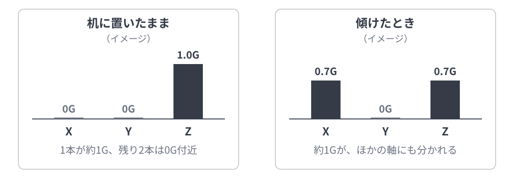

<!-- _class: cover seq -->
<!-- _paginate: false -->
<!-- _backgroundImage: url('assets/avatar-wave.jxl') -->
<!-- _backgroundSize: 220px -->
<!-- _backgroundPosition: right 60px bottom 36px -->
<!-- _backgroundRepeat: no-repeat -->


## Day 2

# サイバーフィジカルシステム<br>プラットフォームとしての Web

Web Serial API で M5Stack Core2 をつなぎ、測って、判断して、動かす

> 2026年12月2日　10:00〜17:00

---

<!-- _class: cols timetable -->

# 今日の時間割

### **午前**

| 時刻 | 内容 |
| --- | --- |
| 10:00 | Day 1 の振り返り、機材の配布 |
| 10:15 | Core2 の配線と動作確認 |
| 10:45 | Web Serial API の基礎 |
| 11:25 | センサー値をモニターする |
| 12:05 | 昼休み |

### **午後**

| 時刻 | 内容 |
| --- | --- |
| 13:05 | センサー値を Prompt API で解説させる |
| 13:35 | サーボの可動範囲を記録する |
| 14:05 | テキストでサーボを動かす |
| 14:30 | Speech Recognition API の基礎 |
| 15:00 | 声でサーボを動かす |
| 15:10 | センサーと音声をつなぐ |
| 16:05 | グループワーク |
| 16:45 | 振り返りと質疑（17:00 終了） |

> 休憩は 11:15、14:50、15:55 に10分ずつ

---

<!-- _class: cols -->
<!-- _backgroundImage: url('assets/avatar-laptop.jxl') -->
<!-- _backgroundSize: 220px -->
<!-- _backgroundPosition: right 60px bottom 36px -->
<!-- _backgroundRepeat: no-repeat -->

# 機材

### **本体とセンサー**

- M5Stack Core2 for AWS
- USB-C ケーブル（データ通信対応）
- 温湿度センサー ENV Ⅲ

### **サーボまわり**

- マイクロサーボ1個
- ブレッドボード（配線済み）
- サーボ用の5V電源

どれも1人1組。全員が自分の Core2 とサーボで演習する

---

<!-- _class: part -->
<!-- _backgroundImage: url('assets/avatar-point-left.jxl') -->
<!-- _backgroundSize: 220px -->
<!-- _backgroundPosition: right 60px bottom 36px -->
<!-- _backgroundRepeat: no-repeat -->

PART 1

# Web から現実の機器へ

## 背景と Web Serial API

---

<!-- _class: flow seq -->

# 現実を測り、判断し、動かす

1. センサー
   - 現実を測る
1. **ブラウザー**
   - 集計して、AI が判断する
1. アクチュエーター
   - 現実を動かす

測った値を計算機の側で処理し、結果を現実へ返す仕組みを、サイバーフィジカルシステム（CPS）と呼ぶ

> 工場の設備監視や、ヘルスケア機器の計測と記録も、この形をしている

---

<!-- _class: cols seq -->

# 今日のサーボで回す1周

### **Core2 とサーボ**

- 加速度と角速度を100ミリ秒ごとに送る
- 届いたコマンドどおりにサーボを回す

### **ブラウザーの1ページ**

- 値を集計してラベルを付ける（JavaScript）
- 状態と言葉の指示を判断する（Prompt API）
- 角度を検証してコマンドを送る（Web Serial API）
- 判断と応答を記録する（OPFS）

サーバーは置かない。止めるのも直すのも、このページの中で済む

---

<!-- _class: compare late-note -->

# Web は少しずつ、機器に手を伸ばしてきた

| 時期 | 届いた先 | API |
| --- | --- | --- |
| 2010年代前半 | 位置、カメラ、マイク | Geolocation API、`getUserMedia()` |
| 2017年 | Bluetooth、USB | Web Bluetooth、WebUSB |
| 2021年 | シリアル、HID | Web Serial API、WebHID |
| 2026年 | Firefox でもシリアル | Web Serial API（Firefox 151） |

> 2017年と2021年は Chrome での対応。どれも、利用者が機器を選んで許可したときだけ届く

---

<!-- _class: cols seq -->

# なぜ USB シリアルなのか

### **開発の現場で一番多い通信路**

- マイコンの開発ボードの多くが、USB シリアル変換チップを載せている
- 書き込みもログの確認も、同じポートで行う
- テキストを1行送るだけなら、手で打って確かめられる

### **WebUSB との違い**

- WebUSB は、OS のドライバーがつかんでいない機器にしか届かない
- Web Serial API は、OS のシリアルドライバーの上で動く
- 既存の機器を、ファームウェアを変えずにつなげることが多い

---

<!-- _class: compare -->

# 保守用アプリを配る代わりに、URL を配る

|  | 専用の保守用アプリ | Web アプリ |
| --- | --- | --- |
| 配布 | OS ごとのインストーラー | URL |
| 更新 | 再配布して入れ直す | 再読み込みで最新版 |
| 対応 OS | OS ごとに作り、検証する | 同じコードが動く |
| 管理者権限 | インストールに必要なことがある | USB シリアルのドライバーだけ |

機器の設定、ログの回収、出荷前の動作確認の画面を、ブラウザーに移せる

---

<!-- _class: compare late-note -->

# 同じコードが、Chrome でも Firefox でも

| ブラウザー | 対応 | 補足 |
| --- | --- | --- |
| Chrome、Edge | デスクトップ版 89 以降 | 追加の設定は不要 |
| Firefox | 151 以降（2026年5月） | サイト権限アドオンで許可する |
| Safari | 非対応 | |

```js
const port = await navigator.serial.requestPort(); // クリックの中で呼ぶ
await port.open({ baudRate: 115200 });
```

> 対応ブラウザーが増えると、「Chrome で開いてください」と断る場面が減る

---

<!-- _class: part -->

PART 2

# Core2 をつなぐ

## 配線とブリッジ

---

# 配線を確かめる



信号線は 330Ω の抵抗を挟んで GPIO へ。配線を誤ったときに流れる電流を抑える

> 信号線は Port B へ。Port B は底面ユニットの側面にある

---

<!-- _class: seq -->

# 電源を入れる前の3点



---

<!-- _class: split -->

# `ping` で応答を確かめる

```json
{
  "board": "core2",
  "servo": true,
  "channels": 2,
  "imu": true,
  "env": true,
  "type": "ok",
  "command": "ping"
}
```

モニターのサンプルの「コマンドを送る」欄から `ping` を送る

**`"board": "unknown"`**
ブリッジの `BOARD` を指定して書き込み直す

**`"env": false`**
ENV Ⅲ が Port A に挿してあるか

---

<!-- _class: proto -->

# ブリッジとの取り決め

コマンドは1行のテキスト、応答は1行の JSON

| コマンド | 動作 |
| --- | --- |
| `ping` | 生存確認。機種、チャンネル数、センサーの有無 |
| `servo 0 90 1 45` | チャンネルごとの角度（0〜180度） |
| `release` | 信号を止めて脱力させる |
| `sensor on` / `off` | センサー値の送信を開始、停止 |
| `sensor 500` | 送信間隔をミリ秒で指定（既定は100） |

```json
{"type": "error", "command": "servo", "message": "angle out of range: 200"}
```

> コマンドは人が手で打って確かめられるようにテキスト、応答は `JSON.parse()` だけで読めるように JSON

---

<!-- _class: part -->

PART 3

# センサー値を読む

## モニターと Prompt API

---

<!-- _class: seq -->

# 静止時と揺れたときの値



`sensor 500` でグラフの伸びが遅くなる

---

<!-- _class: aggregate -->

# 何を集計してから渡すか

直近30件（100ミリ秒ごと、約3秒）から計算し、ラベルを付ける

| 項目 | 計算 | ラベル |
| --- | --- | --- |
| 傾き | 加速度の平均と画面の法線のなす角 | ほぼ水平、裏返し など |
| 揺れ | 加速度の大きさの標準偏差 | 静止、小さな揺れ、大きな揺れ |
| 回転 | 角速度の大きさの最大値 | 数値のみ |
| 落下 | 大きさが 0.3G を下回った瞬間 | あり、なし |

揺れの境目（0.02G と 0.1G）は目安。モニターで見た静止時と揺れの値で決め直す

> Core2 のボタン A でも判断が始まる。モデルの準備は、初回だけ画面のボタンから

---

<!-- _class: part -->
<!-- _backgroundImage: url('assets/avatar-think.jxl') -->
<!-- _backgroundSize: 220px -->
<!-- _backgroundPosition: right 60px bottom 36px -->
<!-- _backgroundRepeat: no-repeat -->

PART 4

# サーボを動かす

## サーボと音声

---

<!-- _class: punch -->

# サーボの可動範囲を記録する

1. サーボの電源を入れてから接続する。サーボが90度に動く
1. スライダーを少しずつ動かし、止まる角度を探す
1. 値を大きくしたときの向きも記録する（例：左を向く）
1. 記録したら「脱力させる」を押す

文字や声で指示しても、記録した範囲の外へはコードが動かさない

「ジー」と鳴ったら、そこから5〜10度戻した値を記録する

---

<!-- _class: hint -->

# `hint` と例を、自分のサーボに合わせる

```js
const SERVO = {
  channel: 0, min: 0, max: 180, home: 90,
  hint: "値を大きくすると左、小さくすると右を向く。90度が正面",
};
```

* `min`／`max`：記録した可動範囲
* `hint`：値を大きくしたときの動きを、モデルが読む文で書く
* 向きが逆なら、例の `add` の符号をすべて逆にし、現在の角度 `120` を `60` に

> Core2 につなぐ前に、文字の入力でモデルの出力を確かめる

---

<!-- _class: speech -->

# 声を認識する場所

| 設定 | 認識する場所 | 必要なもの |
| --- | --- | --- |
| 既定 | Google のサーバー | ネットワーク接続 |
| `processLocally: true` | PC 内 | 日本語の言語パック |

```js
await SpeechRecognition.available(
  { langs: ["ja-JP"], processLocally: true });
// "available" なら PC 内で認識できる
```

マイクが使えないときは、同じ指示を文字で入力する

> 言語パックは、基礎のサンプルで「端末内で処理する」を選ぶと取得できる。声でサーボを動かすサンプルは、取得済みのときだけ PC 内で認識する

---


<!-- _class: part -->
<!-- _backgroundImage: url('assets/avatar-point-left.jxl') -->
<!-- _backgroundSize: 220px -->
<!-- _backgroundPosition: right 60px bottom 36px -->
<!-- _backgroundRepeat: no-repeat -->

PART 5

# センサーと音声をつなぐ

## 連携例とグループワーク

---

# 連携例を起動する

```bash
cd examples/sensor-assistant
npm install
npm start
```

* 「モデルを準備」を押してから「Core2 に接続」
* 動かすのはチャンネル0のサーボ
* 「戻す角度」と「警告の角度」を、記録した可動範囲に合わせる

> ファイルの選択と機器への接続があるので、`http://localhost` のページで試す

---

<!-- _class: flow alarm -->

# 揺れへの警告

1. Core2
   - 100ミリ秒ごとの値
1. コードで集計
   - 2秒以上の集計で<br>揺れ 0.1G 以上
1. Prompt API
   - `level`: alert
1. **コードが送る**
   - `servo 0 120`

* 角度はモデルに作らせない。設定した角度をコードが検証して送る
* 推論中は次の判断を始めない。間隔は5秒以上、警告は解除まで1回
* サーボは机に固定して試す

> ここでの「異常」は演習で決めた条件とモデルの判定。故障の診断ではない

---

<!-- _class: interval punch -->

# 計測間隔を声で変える

| 段階 | 中身 |
| --- | --- |
| 指示 | 「計測間隔を500ミリ秒にして」 |
| モデルの出力 | `"kind": "set_interval", "intervalMs": 500` |
| コードの検証 | 100〜1000ミリ秒の整数か → `sensor 500` |
| Core2 の応答 | `"command": "sensor", "interval": 500` |

`intervalMs` が500、3秒分が約6件なら完了。「10ミリ秒」は拒否される

モデルの値ではなく、Core2 の応答で確かめる

---

<!-- _class: cols qa -->

# 状態への質問と記録の保存

### **状態への質問**

- 「今、揺れていますか」と送る
- `kind` は `query`。機器へは送らない
- 「温度は何度ですか」：集計にない温度を補っていないか

### **記録の保存**

- 判断、指示、送ったコマンド、Core2 の応答を JSON ファイルへ
- OPFS に保存し、再読み込みして表示
- `sent` は送った記録。動きは目で見る

モデルの返事、コードが送ったコマンド、Core2 の応答を照合して終える

---

<!-- _class: cols -->
<!-- _backgroundImage: url('assets/avatar-idea.jxl') -->
<!-- _backgroundSize: 220px -->
<!-- _backgroundPosition: right 60px bottom 36px -->
<!-- _backgroundRepeat: no-repeat -->

# グループワーク

### **課題の例**

- 首を振る
- 緊急停止（すぐ `release`）
- 返事を読み上げる
- `warning` でも小さく警告

### **小さく作って動かして確かめる**

- 1つの動作が動いてから次を足す
- 例を1つ足したら、出力を確かめる
- 動いた状態に戻せるようにする

グループで1つ選び、サンプルを改造する

---

<!-- _class: trouble -->

# 困ったときは

| 症状 | 確かめること |
| --- | --- |
| 選択画面に Core2 が出ない | ドライバー、抜き差しで消えるポート |
| 「接続できませんでした」 | UIFlow2 や別のタブがポートを開いたまま |
| サーボが動かない | 5V電源、GND の共通、信号線が Port B か |
| 動いた瞬間に Core2 が再起動 | サーボの電源を Core2 から取っていないか |

> ほかの症状：kou029w.github.io/intro-to-web-dev/web-ai/troubleshooting.html

---

<!-- _class: compare late-note -->

# 2日間で使った API を、現場に置き換える

| 段階 | 使った API | 現場での置き換え例 |
| --- | --- | --- |
| 測る | Web Serial API | 計測機器、検査治具からの値の取得 |
| 判断する | Prompt API、JavaScript | 異常の一次判定、記録への所見の下書き |
| 動かす | Web Serial API | 設定値の書き込み、試験の手順の実行 |
| 残す | File System Access API、OPFS | 試験記録、ログの保存 |

> どの段階も、サーバーを置かずに、URL を開いた PC の中で動く

---

<!-- _class: cover end seq -->
<!-- _paginate: false -->
<!-- _backgroundImage: url('assets/avatar-wave.jxl') -->
<!-- _backgroundSize: 180px -->
<!-- _backgroundPosition: right 60px bottom 30px -->
<!-- _backgroundRepeat: no-repeat -->


モデルの出力が正しいかを見極める基準は、

# 現場で値を見てきた人が持っている

> 教材：kou029w.github.io/intro-to-web-dev
