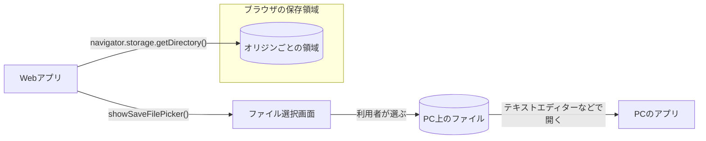

# File System Access APIとOPFS

> **Note**\
> このページは2026年12月の研修に向けて編集中です。内容は変更されることがあります。

モデルの判断やセンサーの計測結果は、ページを閉じた後にも確認できるように保存します。
保存先を利用者が選ぶ方法と、Webアプリ内に保存する方法を試します。

## 保存先を選ぶ方法とアプリ内に保存する方法

利用者がPC上のファイルを選び、その内容を読み書きする場合は、**File System Access API**を使います。
ファイル選択画面で得たハンドルを通じて、選んだファイルにアクセスします。
選択画面はボタンのクリックなどの操作から開き、HTTPSまたは`http://localhost`で配信したページを使います。
操作の条件は[ChromeのFile System Access APIの資料](https://developer.chrome.com/docs/capabilities/web-apis/file-system-access)で確認できます。

一方、Webアプリが保存先を管理する場合は、**OPFS（Origin Private File System）**を使います。
利用者のファイル選択を求めず、ページのオリジンに属する保存領域へ書き込みます。
この領域のファイルは、利用者がPCのフォルダーから開くファイルとは区別されます。
OPFSの仕組みは[WebKitの解説](https://webkit.org/blog/12257/the-file-system-access-api-with-origin-private-file-system/)にも示されています。

オリジンはURLのスキーム、ホスト、ポートの組み合わせです。
たとえば`http://localhost:3000`と`http://localhost:3001`は別のオリジンなので、OPFSの保存領域も異なります。
演習では同じURLからページを開き直してください。

| 比較する項目 | File System Access APIのファイル選択 | OPFS |
| --- | --- | --- |
| 保存先 | 利用者が選んだPC上のファイル | オリジンごとの領域 |
| 選択画面 | 必要です | 不要です |
| ファイルを開く方法 | PCのアプリからも開けます | Webアプリが読み込みます |
| 教材での用途 | 記録を持ち帰ります | 同じWebアプリで記録を表示します |
| 入口 | `showSaveFilePicker()`、`showOpenFilePicker()` | `navigator.storage.getDirectory()` |

保存先の違いを図にすると、次のようになります。



## JSONファイルへの保存

次の例は、保存先を選び、計測間隔とモデルの判断を書き込みます。
このページの「実行」を押すと、ファイル選択画面が開きます。
`showSaveFilePicker`がない環境では処理を止めます。

```js runnable
if (!("showSaveFilePicker" in self)) {
  throw new Error("このブラウザではファイル選択を利用できません。");
}
const handle = await showSaveFilePicker({ suggestedName: "measurement.json" });
const data = { intervalMs: 100, level: "alert", comment: "装置の固定を確認してください" };
const writable = await handle.createWritable();
try {
  await writable.write(JSON.stringify(data, null, 2));
  await writable.close();
  console.log("保存しました。");
} catch (error) {
  await writable.abort().catch(() => {});
  throw error;
}
```

`createWritable()`で書き込み先を作り、`write()`で内容を渡し、`close()`で保存を確定します。
既存のファイルを選ぶと、その内容を置き換えるため、演習用の名前で保存してください。
モデルの推論などで待ってから選択画面を開くと、クリックによる操作の有効期間が切れる場合があります。
上の例と、Day2の[判断と機器の応答を保存する](hardware/sensor-assistant.md#判断と機器の応答を保存する)のサンプルでは、選択画面を先に開きます。

保存後はPCのテキストエディターでファイルを開き、`intervalMs`と`level`を確認します。
ブラウザから読み込む場合は、次の例を実行し、保存したJSONファイルを選びます。

```js runnable
if (!("showOpenFilePicker" in self)) {
  throw new Error("このブラウザではファイル選択を利用できません。");
}
const [handle] = await showOpenFilePicker();
const file = await handle.getFile();
console.log(JSON.parse(await file.text()));
```

## OPFSへの保存と読み込み

次の例は、OPFSのルートを取得し、`measurement.json`へ書き込みます。
`getFileHandle()`の`create: true`は、ファイルがなければ作成する指定です。
ここでも`close()`で保存を確定します。

```js runnable
if (!navigator.storage?.getDirectory) {
  throw new Error("このブラウザではOPFSを利用できません。");
}
const root = await navigator.storage.getDirectory();
const handle = await root.getFileHandle("measurement.json", { create: true });
const writable = await handle.createWritable();
try {
  await writable.write(JSON.stringify({ intervalMs: 500, level: "normal" }));
  await writable.close();
  console.log("OPFSに保存しました。");
} catch (error) {
  await writable.abort().catch(() => {});
  throw error;
}
```

続いてページを再読み込みし、次の例だけを実行してください。
保存した値が表示されれば、ページ内の変数が消えた後もファイルから読み込めています。
未保存の場合はファイルが見つからず、エラーになります。

```js runnable
if (!navigator.storage?.getDirectory) {
  throw new Error("このブラウザではOPFSを利用できません。");
}
const root = await navigator.storage.getDirectory();
const handle = await root.getFileHandle("measurement.json");
console.log(JSON.parse(await (await handle.getFile()).text()));
```

OPFSにはブラウザの保存容量の制限があり、サイトデータの削除やブラウザの保存領域の整理で記録を失う場合があります。
持ち帰る記録は、利用者が選んだファイルにも保存してください。
容量の扱いは[Storage Standard](https://storage.spec.whatwg.org/)に定義されています。

## WebAssemblyからの利用

Wasmのプログラムを動かしても、PCのファイルにアクセスする権限が自動で付くわけではありません。
JavaScriptでハンドルを取得し、読み込んだデータをWasmへ渡すか、推論ライブラリの保存機能を使います。
WebLLMのモデル用キャッシュと、今回作る記録用のOPFSファイルは別に扱います。

OPFSには、Dedicated Worker内で同期的に読み書きする`createSyncAccessHandle()`もあります。
Wasmでデータベースなどを動かす場合に使えますが、今回の記録はメインスレッドの非同期APIで保存します。
APIの定義は[File System Standard](https://fs.spec.whatwg.org/)で確認できます。

センサーとモデルの判断を保存する演習は、[センサーと音声をPrompt APIでつなぐ](hardware/sensor-assistant.md)で行います。
