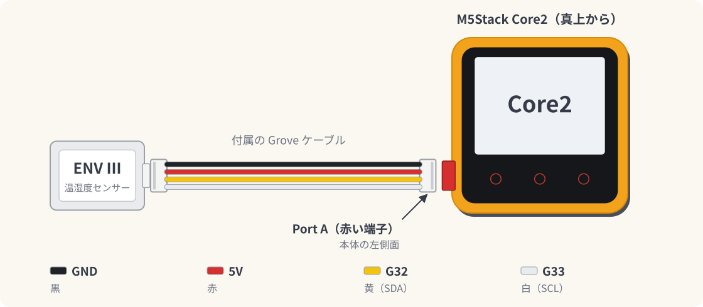

# 温湿度センサーをつなぐ

> **Note**\
> このページは2026年12月の研修に向けて編集中です。内容は変更されることがあります。

[センサー値を表示する](sensor-monitor.md)では、Core2に内蔵されたセンサーの値を受け取りました。
ここでは、外付けの温湿度センサーENV ⅢをCore2につなぎ、同じモニターのサンプルで温度と湿度を表示します。
ここで受け取れるようにした温度と湿度は、[センサー値をPrompt APIで解説させる](sensor-ai.md)と[センサーと音声をPrompt APIでつなぐ](sensor-assistant.md)でモデルに渡します。

## ENV Ⅲ

**ENV Ⅲ**は、M5Stackの温湿度センサーのユニットです。
中には温湿度センサーのSHT30と気圧センサーのQMP6988が入っていて、Groveケーブルの2本の信号線（SDAとSCL）を使うI2Cという方式でCore2と通信します。
このハンズオンのブリッジが読むのはSHT30の温度と湿度だけで、気圧は読みません。

ブリッジは1秒ごとに温度と湿度を測り直し、内蔵センサーの値と同じ`sensor`のメッセージの`env`に入れて送ります。

```json
{"type": "sensor", "time": 12345, "accel": [0.01, -0.02, 0.998], "gyro": [0.1, 0.2, 0.3], "env": {"temperature": 25.3, "humidity": 48.1}, "battery": 87, "charging": false}
```

センサー値は100ミリ秒ごとに届きますが、`env`の値が変わるのは1秒に1回です。
そのあいだのメッセージには、最後に測った値が入っています。

## 温湿度センサーを配線する

ENV Ⅲは、Port A（赤いGrove端子）に付属のGroveケーブルでつなぎます。
Port Aの位置は、[Core2の各部](m5stack-setup.md#core2の各部)で確かめられます。



| ENV Ⅲ | Core2（Port A） | M5Stack Basic（Port A） |
| ----- | --------------- | ----------------------- |
| SDA   | G32（黄）       | G21                     |
| SCL   | G33（白）       | G22                     |

ブリッジは、ENV Ⅲが見つからないあいだ2秒ごとに探し直します。
Core2の電源を入れたまま挿しても、数秒で温度と湿度が届き始めます。

## 温度と湿度を表示する

[センサー値を表示する](sensor-monitor.md#サンプル)のサンプルを開いて接続します。
「そのほかの値」の表の「温度（ENV Ⅲ）」と「湿度（ENV Ⅲ）」に、値が表示されます。

ENV Ⅲに息を吹きかけてみます。
吐く息は水蒸気を多く含むので、湿度は数秒で大きく上がり、しばらくすると元の値に戻ります。
指でつまむと温度も上がりますが、湿度に比べて変化はゆっくりです。

「コマンドを送る」の欄から`ping`を送り、応答が`"env": true`になっていることも確かめます。
挿しているのに`"env": false`のままなら、Port Aに挿しているか（Port Bではないか）を確認してください。

## 値がnullの場合に備える

ENV Ⅲは必須ではありません。
つないでいない場合や途中で外れた場合も、ブリッジは止まらず、`env`を`null`にして送り続けます。
そのためブラウザの側では、`env`が`null`でないことを確かめてから値を使います。

```js
// ENV Ⅲをつないでいないときや読めなかったときは、envがnullになる
document.querySelector("#temperature").value = message.env
  ? `${message.env.temperature.toFixed(1)} ℃`
  : "未接続";
```

確かめずに`message.env.temperature`を読むと、`env`が`null`のときに例外が発生し、受信の処理が止まります。
接続したままENV Ⅲを抜くと、表示が「未接続」に変わり、挿し直すと数秒で値の表示に戻ります。

## 試してみよう

- 湿度が70%を超えたら、表の行の色を変えてみましょう。息を吹きかけて、色が変わるか確かめます。
- 温度と湿度の値を直近60件だけ配列に残し、加速度と同じようにグラフに描いてみましょう。
