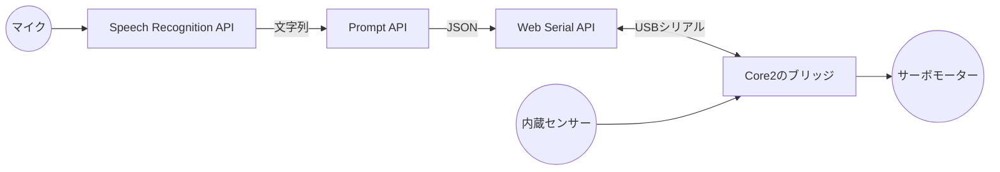

# ハードウェアを動かす

> **Note**\
> このページは2026年12月の研修に向けて編集中です。内容は変更されることがあります。

ブラウザからUSBでつないだM5Stack Core2（以下、Core2）を読み書きし、話しかけた言葉でサーボモーターを動かすハンズオンです。
音声の認識、モデルへの入力、USBシリアル通信をブラウザから呼び出します。
専用アプリのインストールは要りません。

- **Speech Recognition API**：マイクの音声を文字列に変換する
- **Prompt API**：ブラウザに組み込まれた言語モデルで、文字列を構造化されたコマンドに変換する
- **Web Serial API**：USBシリアルでつないだ機器とバイト列をやり取りする

## 全体像

ハンズオンでは、データの流れを2つの向きで扱います。
前半は、Core2の内蔵センサーの値をブラウザで受け取り、Prompt APIに状態を判断させます。
後半は逆向きに、声で出した指示をPrompt APIでコマンドに変換し、Core2に送ってサーボモーターを動かします。



Core2には、USBシリアルとセンサーやサーボモーターのあいだを取り次ぐ小さなプログラム（以下、**ブリッジ**）を書き込んでおきます。
ブリッジは、1行のテキストで届いたコマンドを実行し、センサー値や実行結果を1行のJSONで返します。

## 進め方

配布するCore2には、UIFlow2とブリッジを書き込んであります。
当日は[M5Stack Core2の準備](m5stack-setup.md#温湿度センサーを配線する)の配線から始めます。
当日の時間配分は[Day2](../day2.md)に従います。

1. [Web Serial API](web-serial.md)
2. [センサー値を表示する](sensor-monitor.md)
3. [センサー値をPrompt APIで解説させる](sensor-ai.md)
4. [サーボモーターを動かす](servo.md)
5. [テキストでサーボモーターを動かす](text-servo.md)
6. [Speech Recognition API](speech-recognition.md)
7. [声でサーボモーターを動かす](voice-servo.md)
8. [センサーと音声をPrompt APIでつなぐ](sensor-assistant.md)

最後の演習では、揺れへの警告、計測条件の変更、状態への質問をつなぎます。
判断と機器の応答は、[File System Access APIとOPFS](../file-system.md)で保存します。

## 必要なもの

- M5Stack Core2 for AWS（UIFlow2とブリッジを書き込み済みのもの）と、データ通信に対応したUSB-Cケーブル
- 温湿度センサーのENV Ⅲ（なくても動きます）
- マイクロサーボ（SG90など）1個と、HY2.0-4Pコネクタ 2.54mmオス・コネクタ、メス・コネクタ変換ケーブル（[配線](servo.md#サーボモーターを配線する)を参照）
- Chrome 148以降が動くPC（[環境の確認](../prompt-api/setup.md)でPrompt APIの動作を確認済みのもの）
- マイク（PC内蔵のものでよい）

Prompt APIの使い方は [Prompt API](../prompt-api/index.md) を前提にしています。
セッションの作成、`prompt()`、`responseConstraint`による構造化出力に見覚えがなければ、先に目を通してください。

## サンプルの動かし方

各ページのサンプルは、[LiveCodes](https://livecodes.io/) と [StackBlitz](https://stackblitz.com/) でインストールなしに開けます。
ページに埋め込んだ画面にもWeb Serial APIとマイクの使用を許可してありますが、ポートの選択画面が開かないなど動作しない場合は、バッジから別のタブで開いてください。

手元で動かす場合は、リポジトリを取得してサンプルのディレクトリで次のコマンドを実行します。

```bash
npm install
npm start
```

Web Serial APIとマイクは、`https://`か`http://localhost`で配信したページ（安全なコンテキスト）で使います。
サンプルは`<script type="module">`で書いてあり、HTMLファイルを`file://`で開くとブラウザがスクリプトの読み込みを拒否するため、静的サーバーを経由して開きます（[利用者の操作を起点にする権限モデル](../web-platform.md#利用者の操作を起点にする権限モデル)）。
