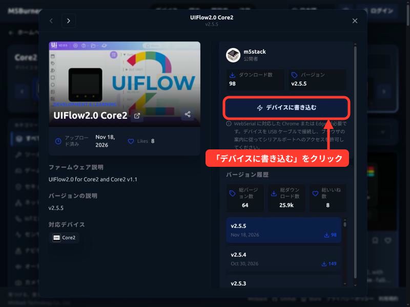
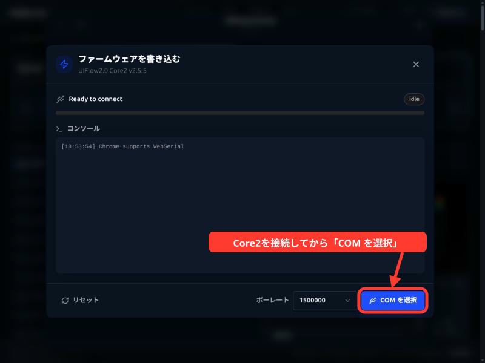
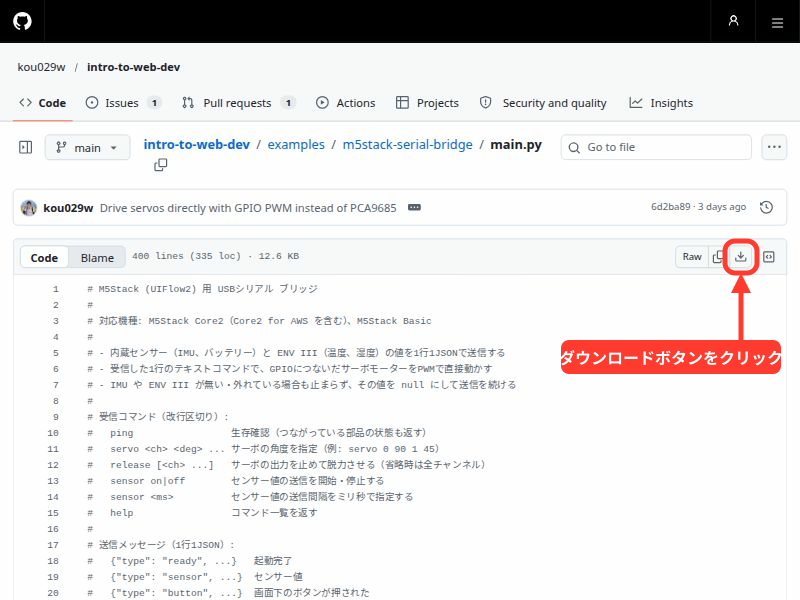
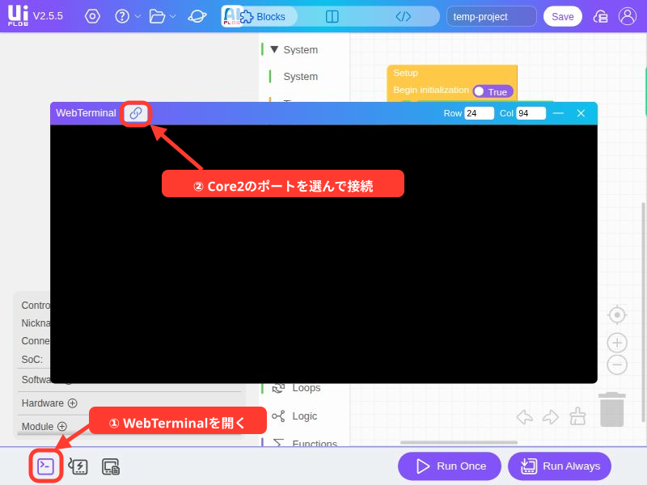
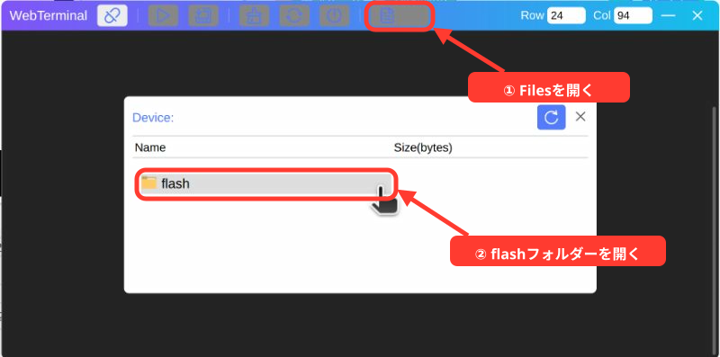
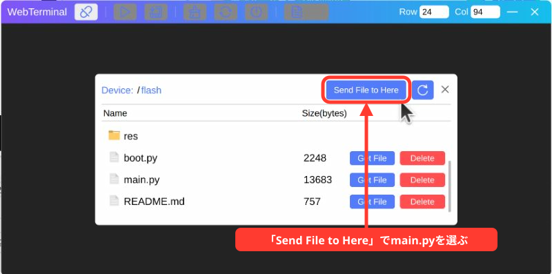
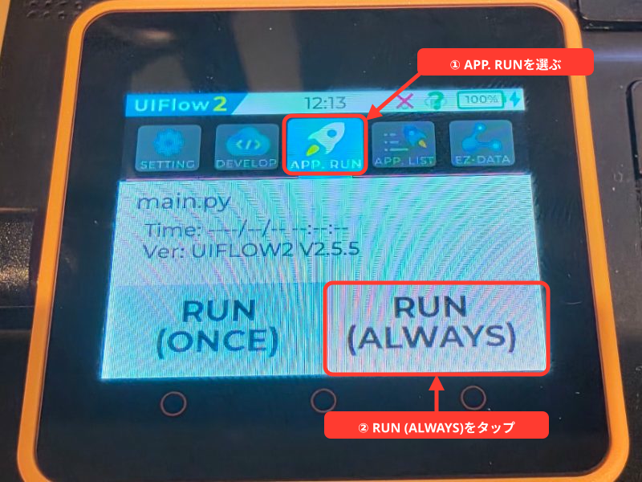
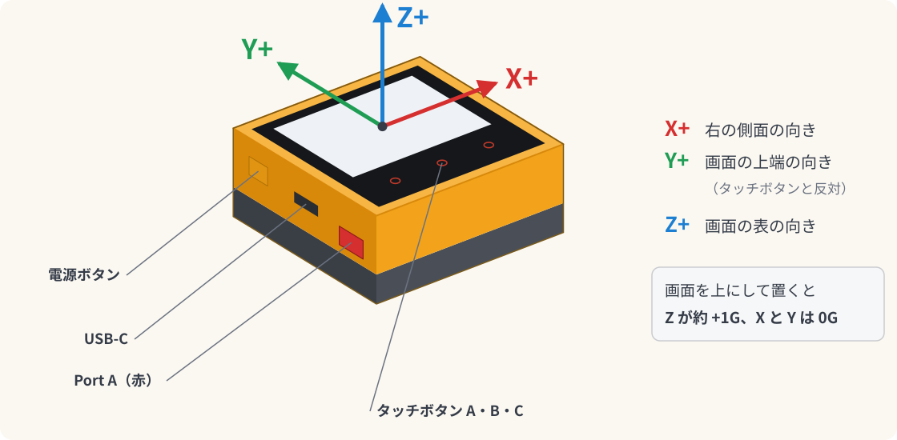

# M5Stack Core2の準備

> **Note**\
> このページは2026年12月の研修に向けて編集中です。内容は変更されることがあります。

M5Stack Core2にブリッジのプログラムを書き込み、内蔵センサーの値がブラウザに届くことを確かめます。
温湿度センサーとサーボモーターは、それぞれ使う直前の[温湿度センサーをつなぐ](env-sensor.md)と[サーボモーターを動かす](servo.md)で配線します。
研修で配布するCore2は、UIFlow2とブリッジを書き込み済みです。
当日は[Core2の各部](#core2の各部)と[動作を確かめる](#動作を確かめる)を行います。

## UIFlow2を書き込む

M5Stack Core2では、**UIFlow2**というファームウェアを使ってMicroPythonのプログラムを動かします。
UIFlow2のファームウェアの書き込みには、M5Stack公式のツール**M5Burner**を使います。

1. Core2のUSBシリアル変換チップ用のドライバー（CP210xまたはCH9102）をインストールします。どちらのチップか分からなければ、両方をインストールして構いません。配布されたCore2を使う場合も、ドライバーは受講前に入れておきます。
2. ChromeでM5Burner（<https://burner.m5stack.com/>）を開き、デバイスの一覧から「Core2」を選びます。M5BurnerはWeb Serialでデバイスに接続するため、ChromeかEdgeで開きます。ログインは不要です。
3. ファームウェアの一覧から「UIFlow2.0 Core2」を選びます。
4. 「デバイスに書き込む」を押します。
5. Core2をUSBケーブルでPCに接続し、「COM を選択」を押して、表示されたポートを選びます。ボーレートは初期値の1500000のままにします。






Wi-Fiの設定を求められた場合も、このハンズオンではWi-Fiを使わないので、設定しなくて構いません。
詳しい手順と画面は、M5Stack公式の[Core2: Flash Firmware & Run Code](https://docs.m5stack.com/en/uiflow2/m5core2/program)を参照してください。

## ブリッジのプログラムを書き込む

ブリッジのプログラムは、`main.py`という1つのファイルです。
このファイルをGitHubからダウンロードし、ブラウザで動く開発環境 [UIFlow2](https://uiflow2.m5stack.com/) を使ってCore2の内蔵フラッシュに置きます。
UIFlow2はブラウザからUSBでCore2に接続するため、ハンズオンと同じChromeで開きます。

### main.pyをダウンロードする

[GitHubのmain.pyのページ](https://github.com/kou029w/intro-to-web-dev/blob/main/examples/m5stack-serial-bridge/main.py)を開き、コードの右上にあるダウンロードボタンを押します。
`main.py`がPCのダウンロードフォルダーに保存されます。



### UIFlow2からCore2に接続する

1. Core2をUSBケーブルでPCに接続します。
2. UIFlow2を開き、左下の「WebTerminal」のボタンを押します。
3. WebTerminalのタイトルの右にある接続のボタンを押し、Core2のポートを選びます。「Connected to Serial Port!」と表示されれば接続できています。



### main.pyをアップロードする

1. WebTerminalの上端にある「Files」のボタンを押し、一覧の「flash」フォルダーを開きます。
2. 「Send File to Here」を押し、ダウンロードした`main.py`を選びます。一覧に`main.py`が表示されればアップロードできています。





### main.pyを実行する

UIFlow2のファームウェアは、起動するとCore2の画面にメニューを表示します。

1. 上段のアイコンから「APP. RUN」をタップします。`main.py`の名前が表示されます。
2. 「RUN (ALWAYS)」をタップします。

「RUN (ONCE)」は1回だけ実行し、「RUN (ALWAYS)」は以後の起動のたびに`main.py`を自動で実行します。
`main.py`が起動すると、画面に「Serial Bridge」と表示されます。



「RUN (ALWAYS)」を選ぶと、起動メニューは表示されなくなります。
ブリッジが動いている間はブリッジがシリアルポートを使い続けるので、UIFlow2から接続して設定を戻すこともできません。
起動メニューに戻すには、次のどちらかを行います。

- Core2の電源を入れ直し、画面に「Tap A: UIFlow menu」と表示されている2秒の間に、画面下の左のボタン（A）をタップします。表示が出る前から押し続けていても反応しないので、表示を見てから何度かタップします。
- ハンズオンのページから`menu`コマンドを送ります。

どちらの場合も、Core2は再起動して起動メニューを表示します。

「Serial Bridge」と表示されたら、UIFlow2のタブを閉じます。
シリアルポートを同時に開けるのは1つのページだけなので、UIFlow2がポートを開いたままだと、ハンズオンのページからは接続できません。

## Core2の各部

配線の前に、Core2のどこに何があるかを確かめておきます。
Port A（赤いGrove端子）は本体の側面にあります。
Port B（黒）とPort C（青）は底面ユニットの側面にあり、画面を正面から見て上側の面に、左からPort B、Port Cの順に並んでいます。


出典：M5Stack「[M5Stack Core2 ESP32 IoT Development Kit for AWS IoT Kit](https://shop.m5stack.com/products/m5stack-core2-esp32-iot-development-kit-for-aws-iot-edukit)」の製品画像

内蔵の加速度センサー（IMU）は、次の図の向きを正として値を返します。
画面を上にして机に置くと、重力の分だけZ軸が約+1Gを示します。



## 動作を確かめる

書き込みが済んだら、[センサー値を表示する](sensor-monitor.md)のサンプルを開いて「接続」を押します。
Core2を傾けたときに加速度のグラフが動けば、ブリッジからブラウザにセンサー値が届いています。

「コマンドを送る」の欄に`ping`と入力して送ると、ログに次のような応答が表示されます。

```json
{
  "board": "core2",
  "servo": true,
  "channels": 2,
  "imu": true,
  "env": false,
  "type": "ok",
  "command": "ping"
}
```

`"board": "unknown"`が返る場合は、ブリッジが機種を判別できていません。
このときも内蔵センサーの値は届き、チャンネル0（G26）のサーボモーターも動きますが、ENV Ⅲは読みません。
プログラムの`BOARD`に`"core2"`か`"basic"`を指定して、書き込み直してください。
ENV Ⅲはまだつないでいないので、`"env"`は`false`です。

## ブリッジとの通信の取り決め

ブリッジは、通信速度115200bpsのUSBシリアルで次のコマンドを受け付けます。
コマンドは1行に1つ、改行で区切って送ります。

| コマンド             | 動作                                                             |
| -------------------- | ---------------------------------------------------------------- |
| `ping`               | 生存確認。機種、チャンネル数、IMUとENV Ⅲの有無も返す             |
| `servo <ch> <deg>`   | チャンネル`ch`のサーボモーターを`deg`度（0〜180）にする          |
| `servo 0 90 1 45`    | 複数のチャンネルをまとめて指定する                               |
| `release [<ch> ...]` | サーボモーターへの信号を止めて脱力させる（省略時は全チャンネル） |
| `sensor on` / `off`  | センサー値の送信を開始または停止する                             |
| `sensor <ms>`        | センサー値の送信間隔をミリ秒で指定する（既定は100）              |
| `menu`               | UIFlow2の起動メニューを表示する設定に戻して再起動する            |

ブリッジからは、1行に1つのJSONが届きます。

```json
{"type": "sensor", "time": 12345, "accel": [0.01, -0.02, 0.998], "gyro": [0.1, 0.2, 0.3], "env": {"temperature": 25.3, "humidity": 48.1}, "battery": 87, "charging": false}
{"type": "button", "name": "A"}
{"servo": {"0": 90}, "type": "ok", "command": "servo"}
{"type": "error", "command": "servo", "message": "angle out of range: 200"}
```

読めなかったセンサーの値は`null`になります。
ENV Ⅲをつないでいなければ`env`が、IMUの無いM5Stack Basicでは`accel`と`gyro`が`null`です。
ブラウザの側では、値を使う前に`null`でないことを確かめます。

送る側と受け取る側で形式を変えているのは、それぞれの読み手が違うからです。
コマンドは、人がシリアルターミナルから手で打って確かめられるよう、短いテキストにしています。
応答は、ブラウザが`JSON.parse()`だけで解釈できるよう、JSONにしています。
