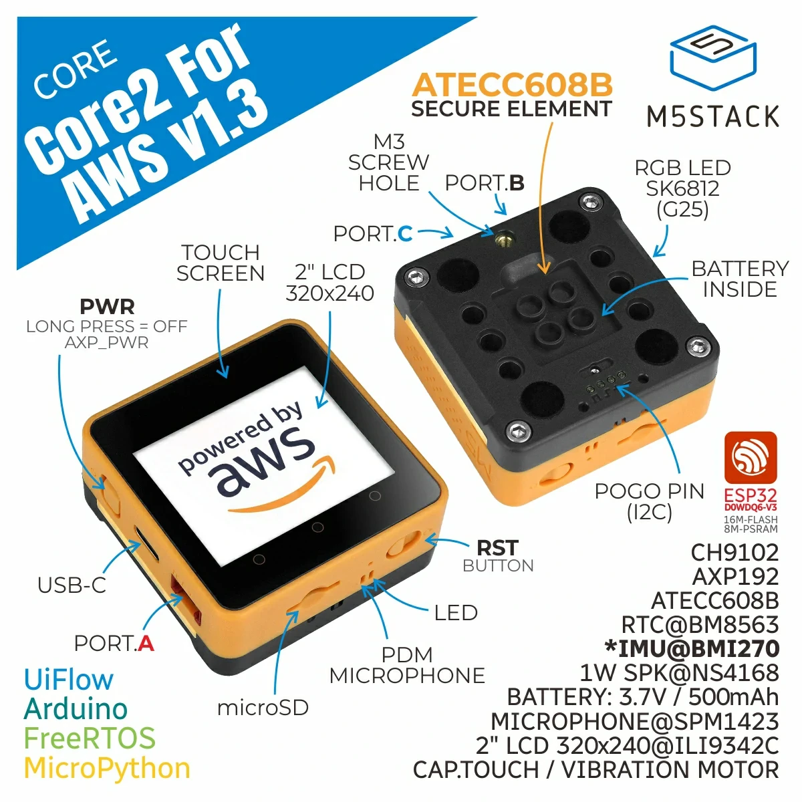
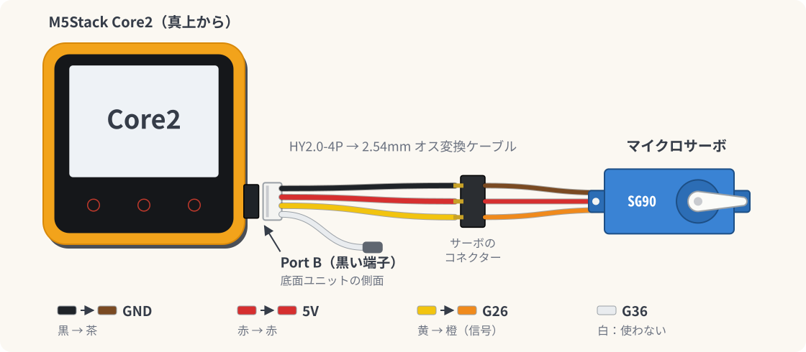
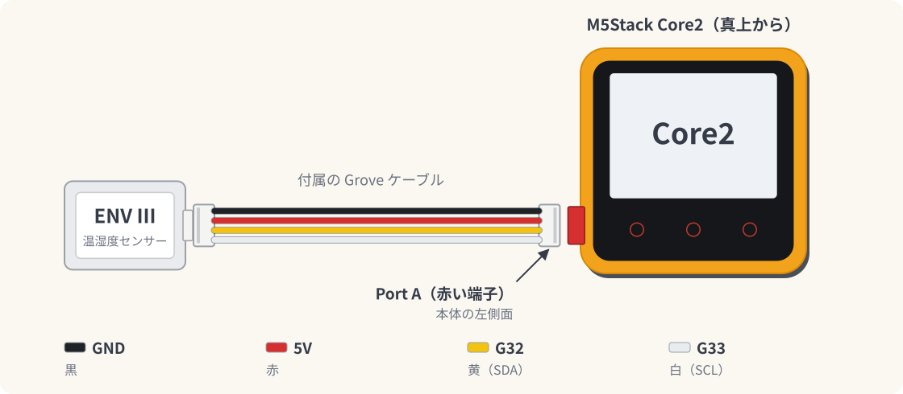
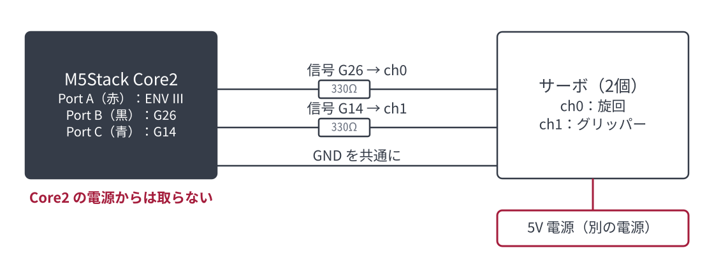

# M5Stack Core2の準備

> **Note**\
> このページは2026年12月の研修に向けて編集中です。内容は変更されることがあります。

M5Stack Core2にブリッジのプログラムを書き込み、サーボモーターを配線します。
研修で配布するCore2は、UIFlow2とブリッジを書き込み済みです。
当日は[Core2の各部](#core2の各部)を確かめ、[サーボモーターを配線する](#サーボモーターを配線する)から[動作を確かめる](#動作を確かめる)まで進めます。

## UIFlow2を書き込む

M5Stack Core2では、**UIFlow2**というファームウェアを使ってMicroPythonのプログラムを動かします。
UIFlow2のファームウェアの書き込みには、M5Stack公式のデスクトップアプリ**M5Burner**を使います。

1. Core2のUSBシリアル変換チップ用のドライバー（CP210xまたはCH9102）をインストールします。どちらのチップか分からなければ、両方をインストールして構いません。配布されたCore2を使う場合も、ドライバーは受講前に入れておきます。
2. [M5Burner](https://docs.m5stack.com/en/download)をインストールして起動し、アカウントでログインします。
3. 機種の一覧からCore2を選び、UIFlow2のファームウェアをダウンロードします。
4. Core2をUSBケーブルでPCに接続し、「Burn」を押してポートを選び、書き込みを始めます。

書き込みの途中でWi-Fiの設定を求められますが、このハンズオンではWi-Fiを使いません。
詳しい手順と画面は、M5Stack公式の[Core2: Flash Firmware & Run Code](https://docs.m5stack.com/en/uiflow2/m5core2/program)を参照してください。

## ブリッジのプログラムを書き込む

プログラムの書き込みには、ブラウザで動く開発環境 [UIFlow2](https://uiflow2.m5stack.com/) を使います。
UIFlow2はブラウザからUSBでCore2に接続するため、ハンズオンと同じChromeで開きます。

1. UIFlow2を開き、「Controller」からCore2を選んで「Confirm」を押します。
2. 「WebTerminal」を押し、Core2のポートを選んで接続します。「Connected to Serial Port!」と表示されれば接続できています。
3. エディターをPythonの表示に切り替え、[ブリッジのプログラム（`main.py`）](https://github.com/kou029w/intro-to-web-dev/blob/main/examples/m5stack-serial-bridge/main.py)の内容で置き換えます。
4. 「Run Always」を押します。プログラムがデバイスの`main.py`として保存され、電源を入れるたびに自動で起動するようになります。
5. Core2の画面に「Serial Bridge」と表示されたら、UIFlow2のタブを閉じます。

最後の手順でタブを閉じるのは、シリアルポートを同時に開けるのは1つのページだけだからです。
UIFlow2がポートを開いたままだと、ハンズオンのページからは接続できません。

## Core2の各部

配線の前に、Core2のどこに何があるかを確かめておきます。
Port A（赤いGrove端子）は本体の側面に、Port B（黒）とPort C（青）は底面ユニットの側面にあります。



出典：M5Stack「[M5Stack Core2 ESP32 IoT Development Kit for AWS IoT Kit](https://shop.m5stack.com/products/m5stack-core2-esp32-iot-development-kit-for-aws-iot-edukit)」の製品画像

内蔵の加速度センサー（IMU）は、次の図の向きを正として値を返します。
画面を上にして机に置くと、重力の分だけZ軸が約+1Gを示します。


## サーボモーターを配線する

ブリッジは、Core2のGPIOからサーボモーター用のPWM信号を直接出します。
ハンズオンでは、サーボモーターを1個、チャンネル0（Port BのG26）につなぎます。
配線には、HY2.0-4Pコネクタと2.54mmのオス・コネクタ、メス・コネクタの変換ケーブル（以下、変換ケーブル）を使います。
変換ケーブルのHY2.0-4P側をPort Bに挿し、オス・コネクタ側をサーボモーターのコネクターに直接挿します。



| 変換ケーブル（Port B） | サーボモーター |
| ---------------------- | -------------- |
| 黒（GND）              | 茶（GND）      |
| 赤（5V）               | 赤（5V）       |
| 黄（G26）              | 橙（信号）     |
| 白（G36）              | つながない     |

変換ケーブルの黒、赤、黄のオス・コネクタを、サーボモーターのコネクターの茶、赤、橙の位置に挿します。
サーボモーターのコネクターは茶、赤、橙の順に並んでいるので、茶色の線の側に黒い線が来るように挿します。
白い線は使わないので、ほかの線に触れないようにしておきます。

サーボモーターの電源は、Port Bの5Vから取ります。
マイクロサーボは内部にコンデンサーを持っているので、抵抗やコンデンサーを外付けせずに直結します。
ただし、サーボホーンが机や配線に当たって回り切れないまま力を出し続けると、流れる電流が増え、Core2が再起動することがあります。
サーボホーンの周りは空けておきます。

ブリッジはチャンネル1（Port CのG14）にも信号を出せますが、ハンズオンでは使いません。

変換ケーブルの線の色は、製品によって公式のピン配置と入れ替わっていることがあります[^grove-color]。
どの線がG26か分からないときは、テスターで確かめます。

[^grove-color]: 公式のピン配置では、Port Bの黄色の線がG26です。テスターで確かめるには、ブリッジに`servo 0 90`を送った状態で、黒の線と他の線のあいだの電圧を測ります。約0.24V（3.3Vのパルスが20ミリ秒のうち1.45ミリ秒だけ出ているときの平均）を示す線がG26です。

M5Stack Basicでは、サーボモーターの信号線を本体側面のピンソケットのG26に、GNDと5Vを同じピンソケットのGNDと5Vにつなぎます。

## 温湿度センサーを配線する

温湿度センサーのENV Ⅲは、Port A（赤いGrove端子）に付属のGroveケーブルでつなぎます。
ENV Ⅲは必須ではありません。
つないでいない場合や、途中で外れた場合も、ブリッジは温湿度の値を`null`にして動き続けます。



| ENV Ⅲ | Core2（Port A） | M5Stack Basic（Port A） |
| ----- | --------------- | ----------------------- |
| SDA   | G32（黄）       | G21                     |
| SCL   | G33（白）       | G22                     |

2つの配線を済ませると、全体は次のようになります。



## ブリッジとの通信の取り決め

ブリッジは、通信速度115200bpsのUSBシリアルで次のコマンドを受け付けます。
コマンドは1行に1つ、改行で区切って送ります。

| コマンド             | 動作                                                             |
| -------------------- | ---------------------------------------------------------------- |
| `ping`               | 生存確認。機種、チャンネル数、IMUとENV Ⅲの有無も返す             |
| `servo <ch> <deg>`   | チャンネル`ch`のサーボモーターを`deg`度（0〜180）にする          |
| `servo 0 90 1 45`    | 複数のチャンネルをまとめて指定する                               |
| `release [<ch> ...]` | サーボモーターへの信号を止めて脱力させる（省略時は全チャンネル） |
| `sensor on` / `off`  | センサー値の送信を開始または停止する                             |
| `sensor <ms>`        | センサー値の送信間隔をミリ秒で指定する（既定は100）              |

ブリッジからは、1行に1つのJSONが届きます。

```json
{"type": "sensor", "time": 12345, "accel": [0.01, -0.02, 0.998], "gyro": [0.1, 0.2, 0.3], "env": {"temperature": 25.3, "humidity": 48.1}, "battery": 87, "charging": false}
{"type": "button", "name": "A"}
{"servo": {"0": 90}, "type": "ok", "command": "servo"}
{"type": "error", "command": "servo", "message": "angle out of range: 200"}
```

読めなかったセンサーの値は`null`になります。
ENV Ⅲをつないでいなければ`env`が、IMUの無いM5Stack Basicでは`accel`と`gyro`が`null`です。
ブラウザの側では、値を使う前に`null`でないことを確かめます。

送る側と受け取る側で形式を変えているのは、それぞれの読み手が違うからです。
コマンドは、人がシリアルターミナルから手で打って確かめられるよう、短いテキストにしています。
応答は、ブラウザが`JSON.parse()`だけで解釈できるよう、JSONにしています。

## 動作を確かめる

書き込みと配線が済んだら、[センサー値を表示する](sensor-monitor.md)のサンプルを開いて接続します。
「コマンドを送る」の欄に`ping`と入力して送ると、ログに次のような応答が表示されます。

```json
{
  "board": "core2",
  "servo": true,
  "channels": 2,
  "imu": true,
  "env": true,
  "type": "ok",
  "command": "ping"
}
```

`"board": "unknown"`が返る場合は、ブリッジが機種を判別できていません。
このときもチャンネル0（G26）のサーボモーターは動きますが、ENV Ⅲは読みません。
プログラムの`BOARD`に`"core2"`か`"basic"`を指定して、書き込み直してください。
ENV Ⅲをつないでいるのに`"env": false`が返る場合は、Port Aに挿しているか（Port Bではないか）を確認してください。
