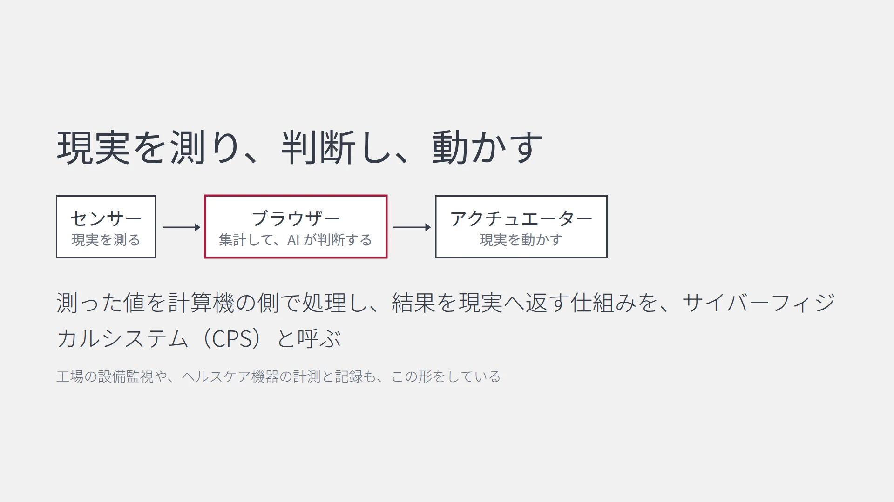

# センサーと音声をPrompt APIでつなぐ

> **Note**\
> このページは2026年12月の研修に向けて編集中です。内容は変更されることがあります。

センサーの値を読む処理、モデルに判断させる処理、機器へコマンドを送る処理をつなぎます。
次の3つを同じサンプルで試します。

- 異常な揺れを検出し、モデルの判断を受けてサーボモーターで警告します。
- 音声で計測間隔を変更します。
- センサーの状態を自然言語で問い合わせます。



[声でサーボモーターを動かす](voice-servo.md)まで進めた後に取り組んでください。
記録の保存には、[File System Access APIとOPFS](../file-system.md)を使います。

## サンプルを起動する

[](https://github.com/kou029w/intro-to-web-dev/tree/main/examples/sensor-assistant)
[](https://livecodes.io/?x=https://github.com/kou029w/intro-to-web-dev/tree/main/examples/sensor-assistant)
[](https://kou029w.github.io/intro-to-web-dev/examples/sensor-assistant/)

「Open in LiveCodes」から開きます。
LiveCodesは初回の読み込みで動かないことがあります。
そのときは「新しいタブで開く」から、このサイトに置いたページを開いてください。

「モデルを準備」を押してから「Core2に接続」を押します。
Core2は100ミリ秒間隔でセンサー値を送り、画面には直近3秒の件数、揺れ、バッテリー残量、計測間隔が表示されます。
計測間隔はCore2の応答で確認できた値を表示します。

このサンプルはチャンネル0のサーボモーターを動かします。
[サーボモーターを動かす](servo.md)で確認した可動範囲に合わせて、「戻す角度」と「警告の角度」を設定してください。
初期値の90度と120度が使えるかどうかは、手元のサーボモーターで確認します。

## 異常な揺れからサーボモーターでの警告へ

Core2を机に置き、静止時の「揺れ」と`deviationG`を確認します。
続いて自動警告を有効にし、Core2を揺らします。
サーボモーターは机に固定して試してください。

サンプルは、加速度の大きさの標準偏差が0.1G以上、集計した時間が2秒以上の場合にモデルを呼び出します。
0.1Gは演習用の境目です。
設置場所に合わせて、サンプルの`core.js`にある境目を調整してください。

モデルには、数値の列を集計した次のようなデータを渡します。

```json
{
  "count": 30,
  "durationMs": 2900,
  "deviationG": 0.18,
  "shake": "大きな揺れ",
  "battery": 87,
  "intervalMs": 100
}
```

モデルはコメントと判定を返します。
`responseConstraint`で判定を`normal`、`warning`、`alert`に限定します。
構造化出力の使い方は[ChromeのPrompt APIの資料](https://developer.chrome.com/docs/ai/prompt-api#pass_a_json_schema)で確認できます。

```js
const judgmentSchema = {
  type: "object",
  properties: {
    comment: { type: "string" },
    level: { type: "string", enum: ["normal", "warning", "alert"] },
  },
  required: ["comment", "level"],
  additionalProperties: false,
};
```

`alert`が返り、判断後も揺れの条件を満たしていれば、ブラウザが設定した角度を送ります。
警告の角度を120度にした場合、送信する行は`servo 0 120`です。
モデルには角度を生成させず、コードが設定値を0〜180度の整数として検証します。
その範囲内でも機械的な可動範囲を越える場合があるため、角度は先に実機で確認します。

推論中は次の判断を始めず、判断の開始間隔も5秒以上空けます。
警告のコマンドは、解除するまで1回だけ送ります。


「自動警告を解除してサーボモーターを戻す」を押すと、自動警告を解除して設定した角度へ戻します。
もう一度試すときは、自動警告を有効にしてください。

この例の「異常」は、演習で定めた揺れの条件とモデルの判定を指します。
実機の故障を診断した結果ではありません。
モデルが`warning`と判定する場合もあるので、記録にある集計と判定を比べ、境目とプロンプトを調整してください。

## 音声で計測条件を変更する

「話す」を押し、「計測間隔を500ミリ秒にして」と話します。
Speech Recognition APIが音声を文字列へ変換し、Prompt APIが変更対象と値を取り出します。
音声を利用できない場合は、入力欄から同じ文を送ります。
音声認識の通信と権限は[Speech Recognition API](speech-recognition.md)で確認してください。

モデルが返す出力の例です。
出力例は説明用であり、文言は実行ごとに変わります。

```json
{
  "kind": "set_interval",
  "intervalMs": 500,
  "reply": "計測間隔を500ミリ秒に変更します。"
}
```

コードは値を検証してから、Core2へ`sensor 500`を送ります。
既存のブリッジが持つコマンドを使うため、ファームウェアを変更する必要はありません。


この演習で変更する計測条件は、センサー値の送信間隔です。

```js
function intervalCommand(value) {
  if (!Number.isInteger(value) || value < 100 || value > 1000) {
    throw new Error("計測間隔は100〜1000ミリ秒の整数で指定してください。");
  }
  return `sensor ${value}`;
}
```

Core2は次のような応答を返します。
画面の`intervalMs`が500になり、3秒分の受信件数が約6件になることを確認します。
「0.5秒ごとに測って」でも同じ値になるか試してください。

```json
{"type":"ok","command":"sensor","enabled":true,"interval":500}
```

「10ミリ秒にして」と指示した場合は、サンプルが定めた範囲外なので送信を拒否します。
JSONとして読める出力でも、実行する値をコードで検証します。
「もっと頻繁に」のように値が決まらない指示には、モデルが`unsupported`を返すよう指示しています。
分類が意図どおりかどうかも、画面の出力で確認してください。

## センサー状態を自然言語で問い合わせる

入力欄から「今、揺れていますか」「バッテリーは何パーセントですか」と送ります。
質問には同じ集計を添え、モデルが集計の内容から返事を作ります。
この場合の`kind`は`query`となり、機器へコマンドを送りません。

```json
{
  "kind": "query",
  "intervalMs": 0,
  "reply": "直近の集計では大きな揺れがあり、バッテリーは87%です。"
}
```

サンプルは毎回セッションを複製し、その時点の集計だけを渡します。
前の質問に添えた測定値を、次の質問の状態として使うことを避けます。
複製したセッションは、成功時もエラー時も`finally`で破棄します。

```js
const session = await base.clone();
try {
  const text = await session.prompt(request, { responseConstraint: requestSchema });
  const result = JSON.parse(text);
  // kindに応じて、検証済みの変更だけを実行します。
} finally {
  session.destroy();
}
```

集計に温度は含めていません。
「温度は何度ですか」と質問し、モデルが測っていない値を補っていないか確認してください。
受信が1.5秒以上止まった場合や、3秒分の集計に3件未満しか残っていない場合は、質問と自動判断を止めます。

## 判断と機器の応答を保存する

警告、計測間隔の変更、質問を試した後、「JSONファイルに保存」を押します。
File System Access APIの選択画面で保存先を指定し、ファイルをテキストエディターで開いてください。
直近500件までの判断、入力した指示、送信したコマンド、機器の応答を保存します。
センサーの全受信値は保存せず、判断や質問に使った集計を記録に含めます。

続いて「OPFSに保存」を押し、ページを再読み込みして「OPFSの記録を表示」を押します。
同じオリジンの保存領域から、前の記録を表示します。
読み込んだ記録のコマンドは実行しません。

保存したJSONの`type`で、処理の段階を区別できます。

| type | 記録する内容 |
| --- | --- |
| `judgment` | 自動判断に使った集計とモデルの判定 |
| `request` | 入力文、集計、モデルの出力 |
| `sent` | ブラウザが送ったコマンド |
| `received` | Core2から届いた実行結果などの応答 |

`sent`は送信の記録であり、サーボモーターが目標角度へ到達した証拠ではありません。
`received`の成功応答もブリッジがコマンドを処理した結果なので、サーボホーンの動きは目で確認します。
モデルの返事と、コードが実行した処理と、機器の応答を照合して演習を終えます。
