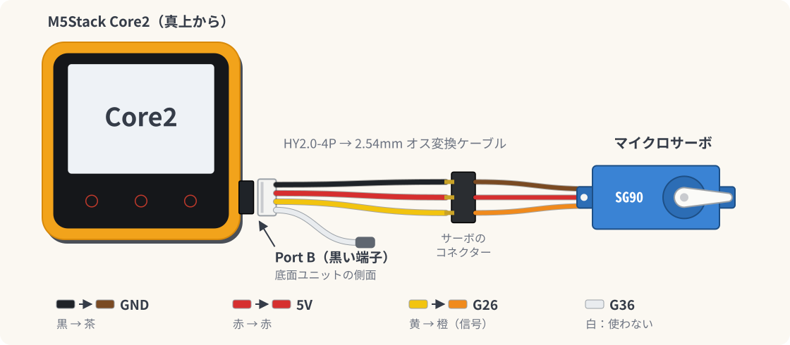
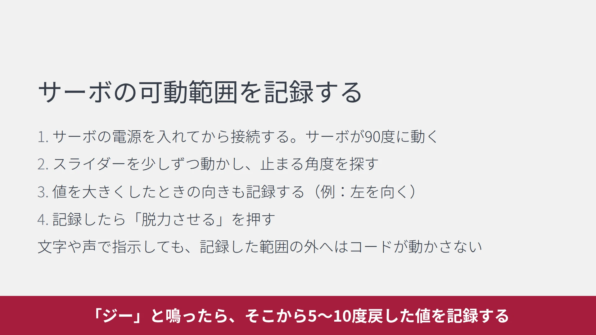

# サーボモーターを動かす

> **Note**\
> このページは2026年12月の研修に向けて編集中です。内容は変更されることがあります。

ここからは、データの向きを逆にして、ブラウザからCore2にコマンドを送ります。
スライダーでサーボモーターの角度を指定し、どこまで動かしてよいか（可動範囲）を確かめます。
ここで確かめた可動範囲は、[テキストでサーボモーターを動かす](text-servo.md)で文字の指示からサーボモーターを動かすときに使います。

## サーボモーターの仕組み

**サーボモーター**は、指示された角度まで回って、その角度を保つモーターです。
ハンズオンでは、マイクロサーボ（SG90など）を1人1個使います。
軸にはサーボホーン（軸に取り付ける樹脂製の腕）を付けておき、その向きで角度を確かめます。
マイクロサーボは、約20ミリ秒ごとに届くパルスの幅で角度を受け取ります。
パルス幅が約0.5ミリ秒なら0度、約2.4ミリ秒なら180度で、そのあいだは幅に比例した角度になります[^pulse]。

このパルスは、Core2のGPIOから直接出します。
ブリッジは`servo 0 90`のようなコマンドを受け取ると、角度をパルス幅に換算し、チャンネル0のGPIO（G26）のPWMに設定します。
以後はESP32のPWMの回路がパルスを出し続けるので、ブリッジが次のコマンドを受け取るまでサーボモーターは同じ角度を保ちます。



[^pulse]: 0度と180度に対応するパルス幅は、サーボモーターの製品ごとに少しずつ異なります。ブリッジのプログラムでは`SERVO_MIN_US`と`SERVO_MAX_US`で設定しています。

## サンプル

[](https://github.com/kou029w/intro-to-web-dev/tree/main/examples/web-serial-servo)
[](https://livecodes.io/?x=https://github.com/kou029w/intro-to-web-dev/tree/main/examples/web-serial-servo)
[](https://stackblitz.com/github/kou029w/intro-to-web-dev/tree/main/examples/web-serial-servo?file=script.js&view=preview)

<iframe loading="lazy" allow="serial" src="https://livecodes.io/?x=https://github.com/kou029w/intro-to-web-dev/tree/main/examples/web-serial-servo" style="width:100%; height:680px; border:0; border-radius:0.5rem;"></iframe>

## 可動範囲を確かめる

サーボモーターは、0度から180度まで回り切れるとは限りません。
製品によっては、0度や180度に対応するパルスを受け取ると、内部の止め（ストッパー）に当たることがあります。
サーボホーンが机や配線に当たる位置でも、それ以上は回れません。
その先の角度を指示すると、サーボモーターは届かない角度に向かって力を出し続け、「ジー」という音を立てて発熱します。
この状態が続くと、サーボモーターの内部の歯車が傷むことがあります。

そこで、実際に動かしながら、安全に動かせる範囲を記録します。

1. サーボモーターの電源を入れてから、「接続」を押してCore2を選びます。接続すると、サーボモーターが初期位置の90度に動きます。
2. スライダーを、左右に少しずつ動かします。音が変わったり、それ以上動かなくなったりした角度を見つけたら、そこから5度から10度戻した値を記録します。
3. 値を大きくしたときにサーボホーンがどちらを向くかも記録します。
4. 記録が済んだら「脱力させる」を押します。

| 最小の角度 | 最大の角度 | 値を大きくしたときの動き |
| ---------- | ---------- | ------------------------ |
|            |            | 例：左を向く             |



「脱力させる」は、ブリッジに`release`コマンドを送り、GPIOのパルスを止めます。
パルスが止まるとサーボモーターは角度を保たなくなり、手でサーボホーンを回せるようになります。
使い終えたときや、サーボモーターから異音がしたときは、脱力させてから原因を調べます。

## コードを読む

### サーボモーターの設定を1か所にまとめる

チャンネルと可動範囲は、`script.js`の先頭の`SERVO`にまとめています。

```js
const SERVO = { channel: 0, min: 0, max: 180, home: 90 };
```

スライダーは`SERVO`をもとに作っているので、`min`と`max`を記録した値に書き換えると、スライダーもその範囲でしか動かなくなります。
ブリッジの側でも0度から180度の範囲外の値は拒否しますが、取り付けたサーボモーターごとの可動範囲まではブリッジは知りません。
その範囲の制限は、ブラウザの側で行います。

### 送信の回数を減らす

スライダーを動かしている間、`input`イベントは1秒間に数十回発生します。
しかし、そのたびにコマンドを送っても、サーボモーターの動きは細かくなりません。
マイクロサーボが60度回るには0.1秒ほどかかり、数ミリ秒ごとに角度を指示しても、回り切る前に次の指示で上書きされるだけだからです。
サンプルでは、50ミリ秒に1回だけ、そのあいだの最後の角度を送っています。

```js
let pendingAngle;
let timer;

function queueServo(angle) {
  pendingAngle = angle;
  timer ??= setTimeout(() => {
    sendLine(`servo ${SERVO.channel} ${pendingAngle}`);
    timer = undefined;
  }, 50);
}
```

`input`イベントのたびに`pendingAngle`を上書きし、送信の予約は1つだけにします。
50ミリ秒のあいだに角度が何度変わっても、送られるのは最後の値だけです。

## 試してみよう

- `SERVO`の`min`と`max`を、記録した可動範囲に書き換えてみましょう。
- 「初期位置に戻す」を押したとき、サーボモーターが一度に動くのではなく、1度ずつゆっくり戻るようにしてみましょう。
- [センサー値をPrompt APIで解説させる](sensor-ai.md)のサンプルと組み合わせて、Core2を傾けた向きにサーボホーンを向けてみましょう。
