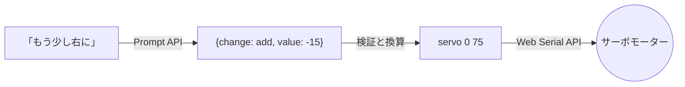
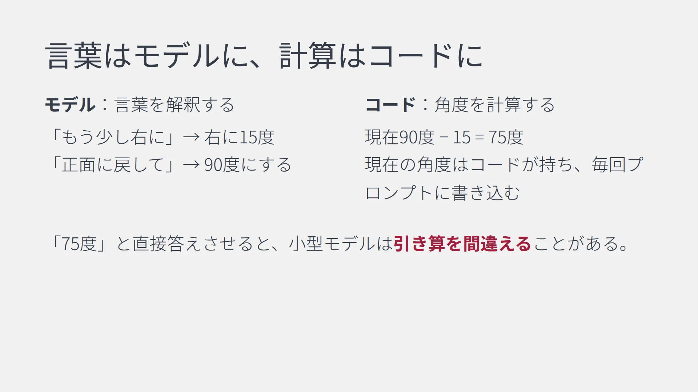

# テキストでサーボモーターを動かす

> **Note**\
> このページは2026年12月の研修に向けて編集中です。内容は変更されることがあります。

[サーボモーターを動かす](servo.md)では、スライダーで角度を数値として指定しました。
ここでは、「左を向いて」「もう少し」のような文字の指示でサーボモーターを動かします。
指示をPrompt APIで角度の変え方を表すJSONに変換し、コードで検証してから、Web Serial APIでCore2に送ります。



この流れは、[声でサーボモーターを動かす](voice-servo.md)の後半と同じです。
先に文字の指示で試しておくと、思いどおりに動かなかったときに、原因がモデルによる変換にあることがはっきりします。
音声を加えると、聞き取りの誤りも原因の候補に入ってきます。

## サンプル

[](https://github.com/kou029w/intro-to-web-dev/tree/main/examples/text-servo)
[](https://kou029w.github.io/intro-to-web-dev/examples/text-servo/)
[](https://livecodes.io/?x=https://github.com/kou029w/intro-to-web-dev/tree/main/examples/text-servo)
[](https://stackblitz.com/github/kou029w/intro-to-web-dev/tree/main/examples/text-servo?file=script.js&view=preview)

<iframe loading="lazy" allow="serial; language-model" src="https://livecodes.io/?x=https://github.com/kou029w/intro-to-web-dev/tree/main/examples/text-servo" style="width:100%; height:680px; border:0; border-radius:0.5rem;"></iframe>

## サーボモーターの設定を書き換える

まず、`script.js`の先頭にある`SERVO`を、[サーボモーターを動かす](servo.md)で記録した可動範囲に合わせます。

```js
const SERVO = {
  channel: 0,
  min: 0,
  max: 180,
  home: 90,
  hint: "値を大きくすると左、小さくすると右を向く。90度が正面",
};
```

`min`と`max`には記録した最小と最大の角度を入れます。
`hint`には、値を大きくしたときの動きを、モデルが読む文章として書きます。
記録したときに「値を大きくすると右を向く」だったなら、`hint`もそのとおりに書き換えます。


向きを逆にした場合は、[入力と出力の例](#入力と出力の例を示す)も逆向きに直します（「左を向いて」に対する`add`の`30`を`-30`に、続く例の現在の角度`120`を`60`に、「もうちょっと」に対する`add`の`15`を`-15`に、「正面に戻して」の例の現在の角度`135`を`45`に、「右を向いてから正面に戻して」に対する`add`の`-30`を`30`に）。

## 動かしてみる

最初は、Core2を接続せずに試します。
「指示する」の欄に「左を向いて」と入力して送信すると、「処理の流れ」の表に、指示、モデルの出力、送信したコマンドが1行ずつ追加され、「現在の角度」のメーターが動きます。
続けて「もう少し」「正面に戻して」「右を向いてから正面に戻して」と送り、角度がどう変わるかを確かめます。
「今日の天気は？」のような、サーボモーターと関係のない指示も送ってみます。

モデルの出力が期待と違っても、ここではサーボモーターは動きません。
意図どおりに動くことを確かめてから、「Core2に接続」を押してサーボモーターを動かします。

## 指示を角度の変え方に変換する

自然言語の指示は、プログラムで実行できるJSONに変換してから使います。
モデルに出力させるJSONの形は、次のスキーマで決めています。

```js
const schema = {
  type: "object",
  properties: {
    actions: {
      type: "array",
      maxItems: 4,
      items: {
        type: "object",
        properties: {
          change: { type: "string", enum: ["set", "add"] },
          value: { type: "integer", minimum: -180, maximum: 180 },
        },
        required: ["change", "value"],
      },
    },
    reply: { type: "string" },
  },
  required: ["actions", "reply"],
};
```

`actions`は、角度の変え方を順に並べた配列です。
「右を向いてから正面に戻して」のように1つの指示に複数の動作が含まれる場合は、動作の数だけ要素が並びます。
`reply`は、利用者に返す短い返事です。

### 角度を直接出力させない

1つの動作は、変え方（`change`）と値（`value`）の2つで表します。
`change`が`"set"`なら`value`の角度にし、`"add"`なら現在の角度に`value`を足します。

「もう少し右に」のような相対的な指示を、モデルに「75度」のような絶対的な角度で答えさせることもできます。
しかし、Gemini Nanoのような小型のモデルは、現在の角度から15を引くといった計算を間違えることがあります。
そこで、モデルには「右に15度」という指示の解釈だけを任せ、足し算はコードで行います。
言葉の解釈はモデルに、計算はコードに、という分担です。


`change`の候補は`enum`で`"set"`と`"add"`に限っているので、それ以外の変え方が返ることはありません。

## モデルに渡す情報

### 角度と向きの説明をシステムプロンプトに入れる

システムプロンプトは、`SERVO`から組み立てています。

```text
あなたはサーボモーターの操作係です。利用者の日本語の指示を、角度の変え方の列に変換します。
サーボモーターの角度は0〜180度です。値を大きくすると左、小さくすると右を向く。90度が正面。
changeが"set"なら角度をvalueにし、"add"なら現在の角度にvalueを足します。
「少し」は15度、程度の指定がなければ30度動かします。
（以下略）
```

「右」「左」のような言葉が、角度を大きくすることなのか小さくすることなのかは、サーボモーターの取り付け方によって異なります。
モデルはこの対応を知らないため、`hint`に書いた説明を手がかりに変換します。
「少し」を何度とみなすかのような、利用者ごとに解釈が分かれる言葉も、ここで決めておきます。

### 入力と出力の例を示す

システムプロンプトのあとには、指示とそれに対する正しい出力の組を5つ並べています。

```js
{ role: "user", content: "現在の角度: 120\n直前の指示: 左を向いて\n指示: もうちょっと" },
{ role: "assistant", content: '{"actions":[{"change":"add","value":15}],"reply":"もう少し左に向けます"}' },
```

小型のモデルは、規則を文章で説明されるよりも、具体的な例を見せられたほうが意図どおりに出力しやすくなります。
例には、相対的な指示、正面に戻す指示、複数の動作を含む指示、サーボモーターと関係のない指示を含めています。
`SERVO`の範囲を変えたら、例の中の値も合わせて直します。
`hint`の向きを逆にしたときは、`add`の値の符号も逆にします。

### 現在の角度と直前の指示を毎回渡す

「もう少し」のような指示を正しく解釈するには、今の角度と、直前に何を指示したかがわからなければなりません。
サンプルでは、指示のたびに元のセッションを`clone()`で複製し、会話の履歴を持たない状態から始めています。
その代わり、現在の角度と直前の指示を、指示の文に毎回書き込みます。

```text
現在の角度: 120
直前の指示: 左を向いて
指示: もうちょっと
```

会話の履歴を1つのセッションに積み重ねていく方法もありますが、指示を重ねるほど履歴が長くなり、応答が遅くなっていきます。
また、角度の正しい値を持っているのはモデルではなくコードです。
コードが持っている現在の角度をそのつど渡せば、モデルが過去のやり取りから角度を推測し損なうことはありません。

## モデルの出力を検証する

スキーマで出力の形を制限しても、モデルの出力をそのままCore2に送るわけにはいきません。
スキーマが保証するのは形だけで、値がサーボモーターにとって安全かどうかまでは保証しないからです。
たとえば可動範囲を20度から160度と記録したのに、`{"change": "set", "value": 180}`が返ることは、スキーマに照らせば正しい出力です。

サンプルでは、送信する前に、コードで角度を検証しています。

```js
function toAngle(action) {
  if (!Number.isInteger(action.value)) return null;
  const target = action.change === "add" ? angle + action.value : action.value;
  return Math.min(SERVO.max, Math.max(SERVO.min, target));
}
```

整数でない値は、その動作ごと捨てます。
角度は`SERVO`の`min`と`max`の範囲に丸めます。
その結果、`min`を20、`max`を160にしていれば、180度を指示する出力が返っても、実際に送られるのは`servo 0 160`です。

安全のための制限は、3か所に重ねてあります。

| 場所             | 制限の内容                                     |
| ---------------- | ---------------------------------------------- |
| スキーマ         | 出力の形、変え方の候補、値の範囲（-180〜180） |
| ブラウザのコード | 記録した可動範囲（`SERVO`の`min`と`max`）     |
| ブリッジ         | サーボモーターが受け付ける範囲（0〜180度）    |

どれか1か所に誤りがあっても、ほかの制限がサーボモーターを守ります。


モデルの出力を画面に表示するときに`textContent`を使うのと同じく、モデルの出力は信頼できない入力として扱います。

## 指示を順番に処理する

モデルが1つの指示を処理している間に、次の指示が届くことがあります。
2つの指示を同時に処理すると、どちらも同じ「現在の角度」をもとに動作を計算し、あとから届いた指示の結果で先の結果を上書きしてしまいます。
サンプルでは、Promiseをつないだ待ち行列を使い、指示を1つずつ順番に処理しています。

```js
let queue = Promise.resolve();

function handleInstruction(instruction) {
  queue = queue.then(() => run(instruction));
}
```

`run()`の中でも、1つの指示に含まれる複数の動作を、0.4秒ずつ間を空けて順に送っています。
「右を向いてから正面に戻して」なら、サーボホーンが右を向き終えてから正面に戻ります。

入力欄の送信は、`handleInstruction()`を呼ぶだけです。
指示の入り口をこの関数1つにまとめておくと、[声でサーボモーターを動かす](voice-servo.md)で音声認識の結果を渡すときも、同じ処理をそのまま使えます。

## 試してみよう

- 「真ん中に」「いちばん右まで」のように、例にない言い方で指示して、モデルの出力を確かめましょう。意図と違う出力が返ったら、例を1つ追加して変化を比べます。
- システムプロンプトの「『少し』は15度」を「『少し』は5度」に書き換え、「もう少し」への出力が変わるかを確かめましょう。
- Core2を接続せずに、`SERVO`の`max`を150にしてから「180度にして」と送り、モデルの出力と送信したコマンドを見比べましょう。

## まとめ

- Prompt APIで文字の指示をJSONに変換し、Web Serial APIでJSONから作ったコマンドを機器に送る
- モデルには言葉の解釈を任せ、角度の計算や範囲の確認はコードで行う
- スキーマの`enum`で、角度の変え方のような選択肢をモデルの出力の段階で限定する
- モデルに渡す指示には、コードが持っている現在の状態を毎回書き込む
- モデルの出力は信頼できない入力として扱い、機器に送る前に検証する

## 声で指示する準備

続いて[Speech Recognition API](speech-recognition.md)で音声を文字列に変換する方法を確かめ、[声でサーボモーターを動かす](voice-servo.md)で、このページの入力欄を声に置き換えます。
