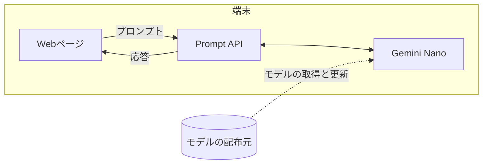

# Prompt API

> **Note**\
> このページは2026年12月の研修に向けて編集中です。内容は変更されることがあります。

Chromeは2026年5月、Prompt APIをバージョン148で安定版にしました。
このAPIを使うと、ブラウザに組み込まれた小型の言語モデル「Gemini Nano」を、サーバーもAPIキーも使わずに呼び出せます。
推論に通信を使わないため、モデルをダウンロードした後は機内モードでも動作し、入力した文章が端末の外に出ることもありません。

次の図は、プロンプトと応答が端末の中だけを行き来し、外部のサーバーとの通信がブラウザによるモデルの取得と更新に限られることを示しています。



## このページで扱うAPIと書き方

- Prompt APIの対応状況の確認方法
- セッションを作成してプロンプトを送る基本的な書き方
- 応答をストリーミングで逐次表示する方法
- JSON Schemaによる構造化出力の使い方
- 地名を指定して気象データを取得し、Prompt APIで自然な日本語の説明に変換する応用例

> **Note**\
> FirefoxやSafariには`LanguageModel`が存在しません。
> これらの環境で以降のコードを実行すると、`ReferenceError`になります。

## 対応状況を確認する

Prompt APIは、モデルのダウンロード状況によって呼び出せる処理が変わります。
まず`LanguageModel.availability()`で、現在の端末で利用できる状態かどうかを確認します。

```js runnable
console.log("LanguageModel" in self);
console.log(await LanguageModel.availability());
```

`"unavailable"`が返る場合、そのブラウザや端末ではPrompt APIを利用できません。
ストレージの空き容量が足りない場合や、GPUの性能が要件に満たない場合がこれに当たります。
モデルが未ダウンロードの場合でも、次に紹介する`LanguageModel.create()`を呼び出すとダウンロードが始まります。

## セッションを作成してプロンプトを送る

Prompt APIとの対話は、**セッション**という単位で行います。
セッションは会話の文脈を保持するオブジェクトで、`LanguageModel.create()`で作成します。

```js runnable
const session = await LanguageModel.create();
const answer = await session.prompt("日本語で自己紹介してください。");

console.log(answer);
session.destroy();
```

`prompt()`は応答の生成が完了するまで待ってから、結果をまとめて返します。
使い終えたセッションは`destroy()`で破棄します。
破棄を忘れるとセッションが専有していたメモリが解放されず、端末のリソースを圧迫し続けます。

モデルが未ダウンロードの状態で`LanguageModel.create()`をページ読み込み時などに呼び出すと、`NotAllowedError`が発生します。
ダウンロードを伴うセッション作成は、クリックやタップなどの**ユーザー操作の延長として**呼び出す必要があるからです。
ボタンの`click`イベントハンドラーの中で呼び出すなど、ユーザーの操作に応じて呼び出す設計にしておきましょう。

応答は`session.prompt()`が返した文字列で、コンソールにそのまま表示しています。
実際の画面に表示する場合は、`element.textContent = answer`のように**テキストとして**書き込む必要があります。
モデルの出力は外部から与えた指示の影響を受けうる、信頼できない文字列だからです。
`innerHTML`に代入するとHTMLとして解釈され、意図しないタグやスクリプトが埋め込まれる可能性があります。

## ストリーミングで応答を逐次表示する

自己紹介程度の短い応答なら`prompt()`で十分ですが、長い文章を生成する場合、応答が完了するまで何も表示されないとユーザーは待たされている印象を受けます。
`promptStreaming()`を使うと、生成された断片を順番に受け取り、逐次表示できます。

```js runnable
const session = await LanguageModel.create();
const stream = session.promptStreaming(
  "日本の四季について、それぞれ一文で紹介してください。",
);

for await (const chunk of stream) {
  console.log(chunk);
}

session.destroy();
```

`for await...of`で受け取る`chunk`は、そのつど新しく生成された断片であり、それまでの全文ではありません。
画面に表示する場合は、`answer += chunk`のように連結しながら追記します。

## 気象データを取得する

ここからは、外部の気象データをPrompt APIに読み解かせる例を作ります。
気象データの取得には、APIキーの登録が不要な[Open-Meteo](https://open-meteo.com/)を使います。

Open-Meteoの予報APIは、緯度と経度を指定して呼び出します。
そこで先立って、**ジオコーディングAPI**で地名を緯度経度に変換します。
こちらもAPIキーは不要です。

```js runnable
const placeName = "Tokyo";

const geoParams = new URLSearchParams({
  name: placeName,
  count: "1",
  language: "ja",
});
const geoResponse = await fetch(
  `https://geocoding-api.open-meteo.com/v1/search?${geoParams}`,
);
const { results } = await geoResponse.json();
const place = results?.[0];
if (!place) throw new Error(`「${placeName}」が見つかりませんでした`);

const params = new URLSearchParams({
  latitude: String(place.latitude),
  longitude: String(place.longitude),
  current: "temperature_2m,weather_code,wind_speed_10m",
});
const response = await fetch(
  `https://api.open-meteo.com/v1/forecast?${params}`,
);
const weather = await response.json();

console.log(weather.current);
```

「Tokyo」のようなローマ字表記で検索し、`language=ja`を付けると「東京都」のような日本語の地名が返ります。
漢字やかなでの検索は未対応です。
予報APIの`current`パラメータで、気温、天気コード、風速という必要な項目だけを指定して取得しています。

`weather_code`は天候の種類を表す数値ですが、数値だけではモデルが正しく解釈できるとは限りません。
Gemini Nanoは端末上で動く小型のモデルであり、この数値コードの割り当てを正確に覚えているとは限らないからです。
そこで、コード側であらかじめ日本語のラベルに変換してからモデルに渡します。

```js
function describeWeatherCode(code) {
  if (code === 0) return "快晴";
  if (code <= 3) return "薄曇りから曇り";
  if (code <= 48) return "霧";
  if (code <= 67) return "雨";
  if (code <= 77) return "雪";
  if (code <= 82) return "にわか雨";
  if (code <= 86) return "にわか雪";
  return "雷雨";
}
```

このマッピングは主要な区分だけをまとめた簡略版です。
正確な区分が必要な場合は、[Open-MeteoのWMO天気コード表](https://open-meteo.com/en/docs#weathervariables)を参照してください。

## 気象データを自然な日本語で説明させる

気温、天気、風速という3つの数値を、生活者向けの一文にまとめさせます。
システムプロンプトで役割を指定しておくと、以後の`prompt()`呼び出しのたびに同じ指示を書く必要がなくなります。

実行ボタンの付いたコードブロックは、どれも単体で動かせるよう、必要な定義をすべて持っています。
そのため、すでに示した取得とラベル変換も含めて、Prompt APIに渡すひと続きのコードとして書き直します。

```js runnable
async function searchPlace(name) {
  const params = new URLSearchParams({ name, count: "1", language: "ja" });
  const response = await fetch(
    `https://geocoding-api.open-meteo.com/v1/search?${params}`,
  );
  const { results } = await response.json();
  return results?.[0] ?? null;
}

async function fetchWeather(place) {
  const params = new URLSearchParams({
    latitude: String(place.latitude),
    longitude: String(place.longitude),
    current: "temperature_2m,weather_code,wind_speed_10m",
  });
  const response = await fetch(
    `https://api.open-meteo.com/v1/forecast?${params}`,
  );
  const { current } = await response.json();
  return current;
}

function describeWeatherCode(code) {
  if (code === 0) return "快晴";
  if (code <= 3) return "薄曇りから曇り";
  if (code <= 48) return "霧";
  if (code <= 67) return "雨";
  if (code <= 77) return "雪";
  if (code <= 82) return "にわか雨";
  if (code <= 86) return "にわか雪";
  return "雷雨";
}

const place = await searchPlace("Tokyo");
const current = await fetchWeather(place);

const session = await LanguageModel.create({
  initialPrompts: [
    {
      role: "system",
      content:
        "あなたは気象データをやさしい日本語で説明するアシスタントです。数値をそのまま読み上げるのではなく、一言コメントを添えてください。",
    },
  ],
});
const label = describeWeatherCode(current.weather_code);
const description = await session.prompt(
  `${place.name}の現在の気温は${current.temperature_2m}度、天気は${label}、風速は${current.wind_speed_10m}m/sです。`,
);

console.log(description);
session.destroy();
```

センサーやAPIから取得した数値そのものではなく、人が読める説明を得られました。
この仕組みは、温度センサーの計測値のような、ほかの数値データの解説にも応用できます。

## 構造化出力で判断結果を得る

説明文だけでなく、「傘が必要かどうか」のような判断結果をプログラムから扱いたい場合があります。
自然文からその都度判断結果を読み取るのは煩雑なので、**JSON Schema**による構造化出力を使います。
`responseConstraint`にJSON Schemaを渡すと、モデルの応答がそのスキーマに従うJSON文字列になります。

```js runnable
async function searchPlace(name) {
  const params = new URLSearchParams({ name, count: "1", language: "ja" });
  const response = await fetch(
    `https://geocoding-api.open-meteo.com/v1/search?${params}`,
  );
  const { results } = await response.json();
  return results?.[0] ?? null;
}

async function fetchWeather(place) {
  const params = new URLSearchParams({
    latitude: String(place.latitude),
    longitude: String(place.longitude),
    current: "temperature_2m,weather_code,wind_speed_10m",
  });
  const response = await fetch(
    `https://api.open-meteo.com/v1/forecast?${params}`,
  );
  const { current } = await response.json();
  return current;
}

function describeWeatherCode(code) {
  if (code === 0) return "快晴";
  if (code <= 3) return "薄曇りから曇り";
  if (code <= 48) return "霧";
  if (code <= 67) return "雨";
  if (code <= 77) return "雪";
  if (code <= 82) return "にわか雨";
  if (code <= 86) return "にわか雪";
  return "雷雨";
}

const schema = {
  type: "object",
  properties: {
    summary: { type: "string" },
    needsUmbrella: { type: "boolean" },
  },
  required: ["summary", "needsUmbrella"],
};
const place = await searchPlace("Tokyo");
const current = await fetchWeather(place);

const session = await LanguageModel.create();
const label = describeWeatherCode(current.weather_code);
const result = await session.prompt(
  `${place.name}の現在の天気は${label}です。降水の有無を踏まえて傘が必要かを判定してください。`,
  { responseConstraint: schema },
);

console.log(JSON.parse(result));
session.destroy();
```

スキーマにはJavaScriptのオブジェクトをそのまま渡し、`JSON.stringify()`で文字列化する必要はありません。
返ってきた`result`は「はい、傘が必要です」のような前置きを含まない、スキーマに沿ったJSON文字列そのものです。
`JSON.parse()`でそのままオブジェクトに変換でき、変換したオブジェクトの`needsUmbrella`を条件分岐に使えます。

決まった選択肢から1つを選ばせたいときは、`enum`で値を列挙します。

```js
const schema = {
  type: "object",
  properties: {
    rain: { type: "string", enum: ["なし", "小雨", "大雨"] },
  },
  required: ["rain"],
};
```

モデルの応答の`rain`は、列挙した3つのどれかになります。

## コラム：AIがコードを書くならプログラミングは不要になるのか

AIがコードを書けるなら、もうプログラミングを学ぶ必要はないのではないか。
AIでWebエンジニアの仕事がどう変わるのか、という疑問もよく聞きます。
コードを書く作業の一部をAIに任せられる場面は、すでに増えています。
ただ、この章で作った傘の判定でも、モデルにすべてを任せてはいません。

モデルに任せたのは、天気のラベルから傘が必要かを判断することです。
天気コードを日本語のラベルに変換する処理は、モデルが覚え違えるおそれがあるため、コードで書きました。
応答の形は`responseConstraint`のJSON Schemaで縛り、`needsUmbrella`を条件分岐に使えるようにしました。
それでも、スキーマが保証するのは形までです。
快晴なのに`needsUmbrella`が`true`になる応答は、スキーマでは防げません。
値の正しさを確かめたいなら、降水量のような計測値と照らし合わせるコードを書くことになります。

どこまでをモデルの判断に任せ、どこからをコードで検証するかを決めるのは、アプリを作る人です。
AIが書いたコードを使う場合も、そのコードがこの分担を守っているかを読んで確かめる必要があります。
コードを打ち込む量が減っても、Webエンジニアの仕事の重心は、この分担を設計して検証するほうへ移っていくと考えられます。
[声でサーボモーターを動かす](../hardware/voice-servo.md#モデルの出力を検証する)でも、同じ分担でモデルの出力を検証してから機器に送ります。

## まとめ

- Prompt APIは`LanguageModel.availability()`で対応状況を確認してから使う
- モデル未ダウンロード時の`LanguageModel.create()`は、クリックなどのユーザー操作の延長で呼び出す
- `prompt()`は一括、`promptStreaming()`は逐次で応答を受け取る
- モデルの出力は信頼できない文字列として扱い、画面に表示する際は`textContent`を使う
- `initialPrompts`のsystemロールで、セッション作成時に役割を指定しておく
- `responseConstraint`にJSON Schemaを渡すと、後処理しやすい構造化出力が得られる
- 外部APIの数値データは、モデルに渡す前に意味のあるラベルへ変換しておくと、モデルが値を読み違えにくくなる
- 使い終えたセッションは`destroy()`で破棄する

## 参考リンク

- Chrome for Developers: [Prompt API](https://developer.chrome.com/docs/ai/prompt-api)（英語）
- Chrome for Developers: [構造化出力の使い方](https://developer.chrome.com/docs/ai/structured-output-for-prompt-api)（英語）
- MDN: [Prompt API](https://developer.mozilla.org/en-US/docs/Web/API/Prompt_API)（英語）
- Microsoft Edge: [Prompt APIのプレイグラウンド](https://microsoftedge.github.io/Demos/built-in-ai/playgrounds/prompt-api/)
- Chrome: [組み込みAIのデモ集](https://chrome.dev/web-ai-demos/)
- [Open-Meteo](https://open-meteo.com/)（APIキー不要の気象データAPI）
