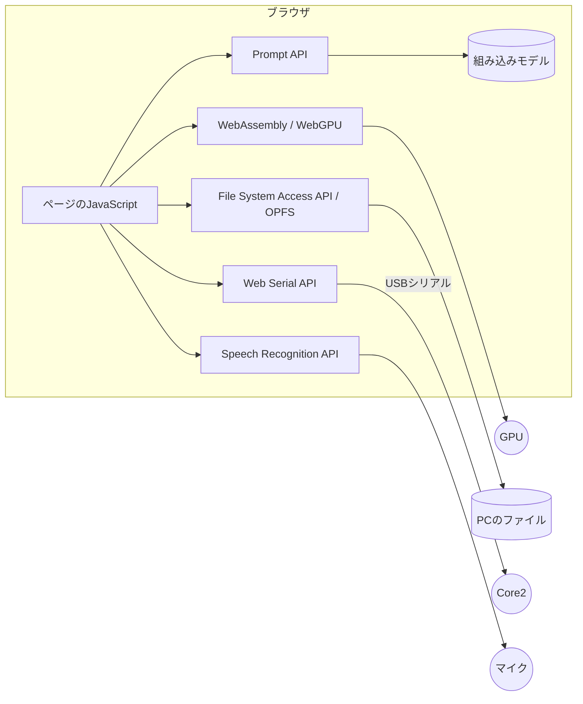

# Webプラットフォームの今

> **Note**\
> このページは2026年12月の研修に向けて編集中です。内容は変更されることがあります。

この2日間では、言語モデルに文章を要約させ、USBでつないだM5Stack Core2のセンサー値を読み、結果をPCのファイルに保存します。
これだけの処理を組み合わせるなら、モデルの実行環境、機器メーカーのSDK、デスクトップアプリの開発環境を、それぞれ用意する必要がありそうです。
この研修で書くのは、ブラウザがそのまま実行するHTMLとJavaScriptだけです。
AIモデルも、シリアル接続の機器も、ローカルのファイルも、Wasmで書かれた計算も、ブラウザという1つの実行環境からJavaScriptで呼び出せます。
ただ、ページのJavaScriptから機器やファイルに手が届くのなら、開いただけのサイトに勝手に操作される心配はないのでしょうか。

## 文書の閲覧から、アプリの実行環境へ

ブラウザは、もともとリンクでつながった文書を読むためのソフトウェアでした。
その後、新しい用途が現れるたびに、それを支えるAPIが標準に加わってきました。

| 時期 | ブラウザでできるようになったこと | 代表的な技術 |
| --- | --- | --- |
| 1990年代 | リンクでつながった文書を読む | HTML、CSS |
| 2000年代 | ページを読み込み直さずに画面を書き換える | Ajax（`XMLHttpRequest`） |
| 2010年代 | 動画の再生、描画、オフライン動作、ホーム画面への追加 | HTML5、Service Worker |
| 2020年代 | GPUでの演算、USB機器との通信、内蔵の言語モデルの呼び出し | WebGPU、Web Serial API、Prompt API |

機能が加わっても、古いページは同じブラウザで動き続けます。
Webの標準は、既存のページを壊さないことを前提に拡張されるからです。

2020年代に加わった機能のいくつかは、2025年から2026年にかけて実用段階に入りました。
WebGPUは2025年にChrome、Firefox、Safariの3つで使えるようになり、WebAssemblyは同じ年の9月に3.0の仕様の完成が発表されました。
Prompt APIは2026年5月のChrome 148で安定版になり、同じ月にはFirefox 151がWeb Serial APIを実装しています。
どれもOSやアプリストアに依存せず、URLを開けば使えます。
一方で、ブラウザでAIモデルを動かせることや、USB機器に届くことは、まだ広く知られていません。
知らなければ、専用アプリを作るか、クラウドのAPIを呼ぶかの2択で設計を始めることになります。

## 新しい機能をいつから使えるか

APIが仕様に載っても、すべてのブラウザがすぐに実装するとは限りません。
使ってよいかを判断する目安として、2つの取り組みがあります。

- **Baseline**：Chrome、Edge、Firefox、Safariのすべてで使える機能に付く印です。2023年に始まり、MDNやCan I useの各機能のページに表示されます。
- **Interop**：ブラウザ各社が、その年に互換性をそろえる分野を決めて取り組むプロジェクトです。2021年から毎年行われ、結果はテストの合格率で公開されます。

この研修の中心にあるPrompt APIとWeb Serial APIは、まだ「Baseline」ではありません。
Prompt APIを安定版として提供しているのはChromeで、Microsoft EdgeはPhi-4-miniを使う実装を試験的に公開しました。
Web Serial APIはChrome、Edge、Firefoxで動き、Safariは対応していません。
そのため、サンプルは最初に対応状況を確かめ、APIがない環境ではその旨を表示します。

## 標準に移ってきた機能

ブラウザの標準機能が足りないあいだは、その部分をライブラリが補ってきました。
標準が追いつくと、ライブラリの役割が標準に移ります。

| かつての手段 | いまの標準 |
| --- | --- |
| jQueryの`$()` | `document.querySelector()` |
| モーダルのライブラリ | `<dialog>`要素、`popover`属性 |
| ツールチップの位置の計算 | CSS Anchor Positioning |
| ページ遷移のアニメーション | View Transitions |
| Sassのネスト | CSS Nesting |
| Lodashの`groupBy`、`cloneDeep` | `Object.groupBy()`、`structuredClone()` |

標準に入った機能は、ライブラリを読み込む必要も、ライブラリの更新を追う必要もありません。
ただし、どのブラウザで使えるかは機能ごとに異なるため、前の節のBaselineで確かめます。

JavaScriptの言語仕様（ECMAScript）は、TC39という委員会が決めています。
提案はStage 0からStage 4までの段階を進み、Stage 4に達したものが、毎年6月に出る新しい版に入ります。
Stage 3は、仕様の内容が固まり、ブラウザが実装する段階です。
それでも、実装して見つかった問題によって仕様が変わることがあり、前の段階に差し戻されることもあります。
クラスに注釈を付けるDecoratorsは、2022年3月にStage 3に達しましたが、どのエンジンも出荷しないまま、2026年5月にStage 2.7へ戻りました。
Stage 3の機能を本番で使うときは、変更に備えておく必要があります。

| 版 | 入った書き方の例 |
| --- | --- |
| ES2022 | トップレベルの`await`、`#`で始まるプライベートフィールド、`at()` |
| ES2023 | 元の配列を変えない`toSorted()`、`findLast()` |
| ES2024 | `Object.groupBy()`、`Promise.withResolvers()` |
| ES2025 | イテレーターヘルパー、`Set`の`union()`など、`Promise.try()`、JSONモジュール |

2025年から2026年にかけても、次の提案がStage 4に達しました。

| Stage 4に達した時期 | 提案 | できること |
| --- | --- | --- |
| 2025年5月 | `Array.fromAsync()`、`Error.isError()` | 非同期の反復から配列を作る、値がエラーかを判定する |
| 2025年7月 | `Math.sumPrecise()`、`Uint8Array`のBase64変換 | 浮動小数点数を誤差なく合計する、バイト列とBase64を変換する |
| 2026年1月 | `Map.prototype.getOrInsert()` | キーに値がなければ入れてから返す |
| 2026年3月 | Temporal | `Date`に代わる日時のAPI。Stage 1から約9年かかった |
| 2026年5月 | `using`による資源の解放、`Iterator.zip()` | スコープを抜けるときに確実に後始末する、複数の反復を位置でまとめる |

2026年のJSConf JPでは、AsyncContextや`Math.sumPrecise()`のような言語の提案、HTML-in-CanvasやFedCMのようなブラウザの新しい機能、npmのサプライチェーン攻撃への備えが話題になりました。
AIを扱う講演も多く、その中には、AIにコードを書かせる話と、Webの上でAIを動かす話の両方があります。
この研修が扱うのは後者です。

## 2日間で使うAPIの位置

ページのJavaScriptは、ブラウザが用意したAPIを通じて、ブラウザの外にあるモデルや機器に届きます。

| API | 橋渡しする先 | 使う日 | 章 |
| --- | --- | --- | --- |
| Prompt API | ブラウザに組み込まれた言語モデル | Day1、Day2 | [Prompt API](prompt-api/index.md) |
| WebAssembly、WebGPU | 開発者が持ち込むモデルと、端末のGPU | Day1 | [WebAssemblyでAIモデルを動かす](webassembly.md) |
| File System Access API、OPFS | PCのファイルと、ブラウザ内のアプリ専用の保存領域 | Day1、Day2 | [File System Access APIとOPFS](file-system.md) |
| Web Serial API | USBシリアルでつないだ機器 | Day2 | [ハードウェアを動かす](hardware/index.md) |
| Speech Recognition API | マイクの音声 | Day2 | [Speech Recognition API](hardware/speech-recognition.md) |

Day1は、ブラウザをAIの実行環境として使う日です。
ブラウザが用意したモデルをPrompt APIで呼ぶ**ビルトインAI**と、開発者が選んだモデルをWebAssemblyとWebGPUで動かす**サードパーティAI**の2つを試します。
Day2は、ブラウザを、センサーで現実を測り、判断し、アクチュエーターで現実を動かす仕組みの中心に置く日です。
こうした仕組みは**サイバーフィジカルシステム**（CPS）と呼ばれ、工場の設備監視やヘルスケア機器の計測にも同じ形が現れます。

Day2の最後の演習では、この表のAPIのうち4つを1つのページでつなぎます。
声で出した指示をPrompt APIでコマンドに変え、Web Serial APIでCore2に送り、モデルの判断と機器の応答をファイルに保存します。

## 共通する性質

どのAPIも、ブラウザに最初から入っています。
ブラウザの側に追加するソフトウェアはなく、OSの側で必要になるのは、Core2のUSBシリアル変換チップ用のドライバーです（[M5Stack Core2の準備](hardware/m5stack-setup.md)）。
サンプルを手元で動かすときの`npm install`が入れるのは静的サーバーで、APIを使うための部品ではありません。

同じHTMLが、Windows、macOS、Linuxで動きます。
シリアルポートの名前はWindowsならCOM3、Linuxなら`/dev/ttyUSB0`のように異なりますが、ポートは利用者が選択画面で選ぶため、コードはその名前を知らずに済みます。

処理の多くは、端末の中で完結します。
Prompt APIは、モデルをダウンロードした後は機内モードでも動作します。
WebLLMは、初回にライブラリとモデルをネットワークから取得しますが、推論時の入力文は端末で処理します。
Web Serial APIとOPFSは、そもそも通信を使いません。
例外はSpeech Recognition APIで、Chromeでは既定でサーバーが音声を処理します。
端末内で認識させるには、`processLocally`と言語パックが必要です。

## 処理をサーバーから端末へ戻す理由

ここ十数年のWebアプリは、処理の多くをサーバーに置いてきました。
AIも同じで、文章の要約や分類は、クラウドのAPIに入力を送って結果を受け取る形が一般的です。
この研修では、同じ処理を端末の中で行う形を扱います。

| | サーバー中心 | クライアント中心 |
| --- | --- | --- |
| データの行き先 | サーバーへ送る | 端末の中にとどまる |
| 運用の費用 | サーバー代、APIの従量課金 | 静的なファイルの配信だけ |
| 通信が切れたとき | 止まる | 読み込んだ後は動く |
| 配布と更新 | サーバーを更新する | URLを配り、再読み込みで更新する |

クライアント中心の形は、閉域網や通信できない現場にも持ち込めます。
USB機器の設定やログの回収のように、これまでOSごとの専用アプリを配っていた作業も、URLを配るだけで済むようになります。

代わりに引き受けるものもあります。
端末で動く言語モデルは小さく、知識も計算もクラウドの大型モデルより間違えやすい傾向があります。
モデルを置くための空きストレージと、GPUか十分なメモリも必要です。
この研修の演習で、数値をコードで集計してから渡し、モデルの出力をコードで検証するのは、小さなモデルの弱点を補うためです。

モデルの性能は年ごとに上がり、モデルどうしの差は縮まっていきます。
入れ替わっても残るのは、どの値が異常かを知っている現場の知識と、その判断を毎日使える画面に落とし込む設計です。
Day1のミニチャレンジで自分の業務を題材にするのは、そのためです。

## 利用者の操作を起点にする権限モデル

冒頭の心配が当たるとしたら、閲覧したサイトが、利用者の知らないうちに機器の設定を書き換えたり、ファイルを読み出したりできてしまいます。
そうならないように、2日間で使うAPIの多くは、クリックなどの**ユーザー操作の延長**でしか呼び出せず、アクセス先は利用者が決めます。

| API | 呼び出しの条件 | 利用者が決めること |
| --- | --- | --- |
| Prompt API | モデル未ダウンロード時の`LanguageModel.create()`はユーザー操作の延長 | なし（ボタンを押すことが条件） |
| Web Serial API | `navigator.serial.requestPort()`はユーザー操作の延長 | 選択画面で、どのポートを使わせるか |
| File System Access API | `showSaveFilePicker()`などはユーザー操作の延長 | 選択画面で、どのファイルに保存するか |
| OPFS | ユーザー操作は不要 | なし（ブラウザ内のアプリ専用の領域だけを使う） |
| Speech Recognition API | 聞き取りの開始時にマイクの許可を求める | マイクの使用を許可するか |

もう1つの条件は、ページの配信元です。
Web Serial API、File System Access API、OPFS、WebGPU、マイクは、`https://`か`http://localhost`で配信したページ（**安全なコンテキスト**）で使う前提のAPIです。
Day1のサンプルは、ページ内の実行ブロックや埋め込みのLiveCodesで、インストールなしに試せます。
Day2のファイル選択とWeb Serial APIは、`npm start`で起動した`http://localhost`のページで試すことを勧めます。
[センサーと音声をPrompt APIでつなぐ](hardware/sensor-assistant.md)のサンプルは、`npm start`で起動して開きます。

HTMLファイルをダブルクリックして`file://`で開くと、どのサンプルも動きません。
サンプルはすべて`<script type="module">`でJavaScriptを読み込んでおり、ブラウザは`file://`のページからのモジュールスクリプトの読み込みを拒否するからです。

この2つの条件は、APIが動かないときに最初に疑う場所でもあります。
ページの読み込み時に`requestPort()`を呼ぶと失敗するのは、権限モデルが意図どおりに働いた結果です。

## サンプルで使っているJavaScriptとHTMLの機能

研修のサンプルは、フレームワークもビルドも使わず、ブラウザがそのまま実行できるJavaScriptで書いています。
その中には、比較的新しくブラウザに揃った書き方がいくつか含まれます。

| 機能 | 使っている場所 | 役割 |
| --- | --- | --- |
| `<script type="module">`と`import` | すべてのサンプル | ファイルを分け、CDNのライブラリ（WebLLM）を読み込む |
| `async`と`await` | すべてのサンプル | モデルの応答やシリアルの受信を待つ |
| トップレベルの`await` | 受講環境の確認、WebLLMのサンプル | `navigator.gpu?.requestAdapter()`の結果を関数で包まずに待つ |
| `for await...of` | Prompt APIのサンプル | `promptStreaming()`が返す断片を順に受け取る |
| `ReadableStream`と`getReader()` | Web Serial APIのサンプル | `port.readable`からバイト列の断片を受け取る |
| `?.`、`??`、`??=` | 対応状況の確認、音声認識、センサー値の解説のサンプル | APIのない環境を判定する、接頭辞付きの名前に切り替える、セッションを一度だけ作る |

Prompt APIの`promptStreaming()`が返す値も、`ReadableStream`です。
モデルの応答とシリアルの受信は、同じストリームの仕組みで、届いた分から順に処理します。

HTMLとCSSの側は、`<form>`、`<output>`、`<progress>`、Flexboxの`gap`のような基本的な要素とプロパティだけで組んでいます。
新しいAPIを試すページでは、画面の仕組みを増やさないほうが、APIの動きを追いやすいからです。

## コラム：URLを入れてから画面が出るまでにブラウザがしていること

ブラウザは、URLを受け取るとHTTPでHTMLを取得し、それを解析してDOMという木構造を組み立てます。
CSSを当てはめて各要素の大きさと位置を計算し、画面に描画します。
読み込んだJavaScriptは、ブラウザに内蔵されたJavaScriptエンジン（ChromeならV8）が実行し、DOMを書き換えて画面を変えます。

Chromeは、この処理を複数のプロセスに分けて動かしています。
ページを描画しJavaScriptを実行するプロセスは、サンドボックスの中で動き、USB機器やファイルに直接は触れられません。
デバイスやファイルへのアクセスは、ブラウザ本体のプロセスが取り次ぎます。
ポートやファイルの選択画面を出しているのも、ページではなくブラウザ本体です。

ページのコードがどれだけ書き換えられても、選択画面で利用者が選ばない限り、機器には届きません。
前の節の権限モデルは、この構造の上に成り立っています。

## コラム：React、Next.js、Vite、Tailwind CSSと新しい名前が次々に出てくる理由

Web開発の記事を読むと、React、Next.js、Vite、Tailwind CSSのような名前が次々に出てきます。
これらは、それぞれ別の層の問題を解くための道具です。
Reactは画面を部品に分けて組み立て、Next.jsはReactの画面をサーバーとどう分担して配信するかを決めます。
Viteは開発中のファイルの変換と配信を、Tailwind CSSはCSSの書き方を扱います。

新しい名前が出続けるのは、Webで作るアプリの規模と要求が変わり続けているからです。
ブラウザの標準機能が追いつく前に、足りない部分をライブラリが補い、npmで誰でも公開できるため、同じ問題に複数の答えが並びます。
標準が追いつくと、[標準に移ってきた機能](#標準に移ってきた機能)の表のように、ライブラリの役割が標準に移ることもあります。

この研修では、フレームワークを使わず、Web標準のAPIを直接呼びます。
Prompt APIやWeb Serial APIは、どのフレームワークを使っても、最後は同じ`LanguageModel`や`navigator.serial`を呼び出します。
フレームワークの名前が入れ替わっても、その下で呼ばれる標準のAPIは使い続けられます。

## 参考

- TC39: [tc39/notes](https://github.com/tc39/notes)（会議の議事録、英語）
- TC39: [The TC39 Process](https://tc39.es/process-document/)（英語）
- JSConf JP 2026: [Schedule](https://jsconf.jp/2026/en/schedule)（英語）
- web.dev: [Baseline](https://web.dev/baseline)（英語）
- web-platform-tests: [Interop Dashboard](https://wpt.fyi/interop)（英語）
- MDN: [Secure contexts](https://developer.mozilla.org/en-US/docs/Web/Security/Secure_Contexts)（英語）
- MDN: [User activation](https://developer.mozilla.org/en-US/docs/Web/Security/User_activation)（英語）
- MDN: [Streams API](https://developer.mozilla.org/en-US/docs/Web/API/Streams_API)（英語）
- Chrome for Developers: [Inside look at modern web browser (part 1)](https://developer.chrome.com/blog/inside-browser-part1)（英語）
