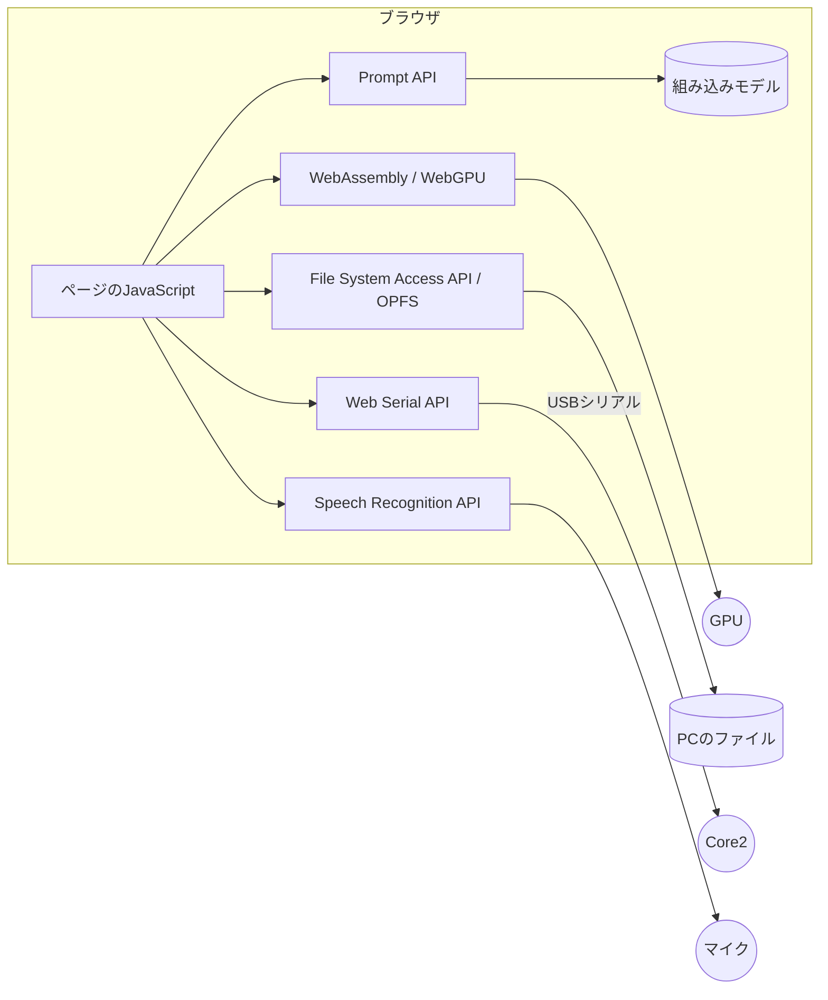

# Webプラットフォームの今

> **Note**\
> このページは2026年12月の研修に向けて編集中です。内容は変更されることがあります。

この2日間では、言語モデルに文章を要約させ、USBでつないだM5Stack Core2のセンサー値を読み、結果をPCのファイルに保存します。
これだけの処理を組み合わせるなら、モデルの実行環境、機器メーカーのSDK、デスクトップアプリの開発環境を、それぞれ用意する必要がありそうです。
この研修で書くのは、ブラウザがそのまま実行するHTMLとJavaScriptだけです。
AIモデルも、シリアル接続の機器も、ローカルのファイルも、Wasmで書かれた計算も、ブラウザという1つの実行環境からJavaScriptで呼び出せます。
ただ、ページのJavaScriptから機器やファイルに手が届くのなら、開いただけのサイトに勝手に操作される心配はないのでしょうか。

## 2日間で使うAPIの位置

ページのJavaScriptは、ブラウザが用意したAPIを通じて、ブラウザの外にあるモデルや機器に届きます。

| API | 橋渡しする先 | 使う日 | 章 |
| --- | --- | --- | --- |
| Prompt API | ブラウザに組み込まれた言語モデル | Day1、Day2 | [Prompt API入門](prompt-api.md) |
| WebAssembly、WebGPU | 開発者が持ち込むモデルと、端末のGPU | Day1 | [WebAssemblyでAIモデルを動かす](webassembly.md) |
| File System Access API、OPFS | PCのファイルと、ブラウザ内のアプリ専用の保存領域 | Day1、Day2 | [File System Access APIとOPFSで記録を保存する](file-system.md) |
| Web Serial API | USBシリアルでつないだ機器 | Day2 | [Webブラウザからハードウェアを動かす](web-serial/index.md) |
| Speech Recognition API | マイクの音声 | Day2 | [Speech Recognition APIの基礎](web-serial/speech-recognition.md) |

Day2の最後の演習では、この表のAPIのうち4つを1つのページでつなぎます。
声で出した指示をPrompt APIでコマンドに変え、Web Serial APIでCore2に送り、モデルの判断と機器の応答をファイルに保存します。

## 共通する性質

どのAPIも、ブラウザに最初から入っています。
ブラウザの側に追加するソフトウェアはなく、OSの側で必要になるのは、Core2のUSBシリアル変換チップ用のドライバーです（[M5Stack Core2の準備](web-serial/m5stack-setup.md)）。
サンプルを手元で動かすときの`npm install`が入れるのは静的サーバーで、APIを使うための部品ではありません。

同じHTMLが、Windows、macOS、Linuxで動きます。
シリアルポートの名前はWindowsならCOM3、Linuxなら`/dev/ttyUSB0`のように異なりますが、ポートは利用者が選択画面で選ぶため、コードはその名前を知らずに済みます。

処理の多くは、端末の中で完結します。
Prompt APIは、モデルをダウンロードした後は機内モードでも動作します。
WebLLMは、初回にライブラリとモデルをネットワークから取得しますが、推論時の入力文は端末で処理します。
Web Serial APIとOPFSは、そもそも通信を使いません。
例外はSpeech Recognition APIで、Chromeでは既定でサーバーが音声を処理します。
端末内で認識させるには、`processLocally`と言語パックが必要です。

## 利用者の操作を起点にする権限モデル

冒頭の心配が当たるとしたら、閲覧したサイトが、利用者の知らないうちに機器の設定を書き換えたり、ファイルを読み出したりできてしまいます。
そうならないように、2日間で使うAPIの多くは、クリックなどの**ユーザー操作の延長**でしか呼び出せず、アクセス先は利用者が決めます。

| API | 呼び出しの条件 | 利用者が決めること |
| --- | --- | --- |
| Prompt API | モデル未ダウンロード時の`LanguageModel.create()`はユーザー操作の延長 | なし（ボタンを押すことが条件） |
| Web Serial API | `navigator.serial.requestPort()`はユーザー操作の延長 | 選択画面で、どのポートを使わせるか |
| File System Access API | `showSaveFilePicker()`などはユーザー操作の延長 | 選択画面で、どのファイルに保存するか |
| OPFS | ユーザー操作は不要 | なし（ブラウザ内のアプリ専用の領域だけを使う） |
| Speech Recognition API | 聞き取りの開始時にマイクの許可を求める | マイクの使用を許可するか |

もう1つの条件は、ページの配信元です。
Web Serial API、File System Access API、OPFS、WebGPU、マイクは、`https://`か`http://localhost`で配信したページ（**安全なコンテキスト**）で使う前提のAPIです。
Day1のサンプルは、ページ内の実行ブロックや埋め込みのLiveCodesで、インストールなしに試せます。
Day2のファイル選択とWeb Serial APIは、`npm start`で起動した`http://localhost`のページで試すことを勧めます。
[センサーと音声をPrompt APIでつなぐ](web-serial/sensor-assistant.md)のサンプルは、`npm start`で起動して開きます。

HTMLファイルをダブルクリックして`file://`で開くと、どのサンプルも動きません。
サンプルはすべて`<script type="module">`でJavaScriptを読み込んでおり、ブラウザは`file://`のページからのモジュールスクリプトの読み込みを拒否するからです。

この2つの条件は、APIが動かないときに最初に疑う場所でもあります。
ページの読み込み時に`requestPort()`を呼ぶと失敗するのは、権限モデルが意図どおりに働いた結果です。

## サンプルで使っているJavaScriptとHTMLの機能

研修のサンプルは、フレームワークもビルドも使わず、ブラウザがそのまま実行できるJavaScriptで書いています。
その中には、比較的新しくブラウザに揃った書き方がいくつか含まれます。

| 機能 | 使っている場所 | 役割 |
| --- | --- | --- |
| `<script type="module">`と`import` | すべてのサンプル | ファイルを分け、CDNのライブラリ（WebLLM）を読み込む |
| `async`と`await` | すべてのサンプル | モデルの応答やシリアルの受信を待つ |
| トップレベルの`await` | 受講環境の確認、WebLLMのサンプル | `navigator.gpu?.requestAdapter()`の結果を関数で包まずに待つ |
| `for await...of` | Prompt APIのサンプル | `promptStreaming()`が返す断片を順に受け取る |
| `ReadableStream`と`getReader()` | Web Serial APIのサンプル | `port.readable`からバイト列の断片を受け取る |
| `?.`、`??`、`??=` | 対応状況の確認、音声認識、センサー値の解説のサンプル | APIのない環境を判定する、接頭辞付きの名前に切り替える、セッションを一度だけ作る |

Prompt APIの`promptStreaming()`が返す値も、`ReadableStream`です。
モデルの応答とシリアルの受信は、同じストリームの仕組みで、届いた分から順に処理します。

HTMLとCSSの側は、`<form>`、`<output>`、`<progress>`、Flexboxの`gap`のような基本的な要素とプロパティだけで組んでいます。
新しいAPIを試すページでは、画面の仕組みを増やさないほうが、APIの動きを追いやすいからです。

## コラム：URLを入れてから画面が出るまでにブラウザがしていること

ブラウザは、URLを受け取るとHTTPでHTMLを取得し、それを解析してDOMという木構造を組み立てます。
CSSを当てはめて各要素の大きさと位置を計算し、画面に描画します。
読み込んだJavaScriptは、ブラウザに内蔵されたJavaScriptエンジン（ChromeならV8）が実行し、DOMを書き換えて画面を変えます。

Chromeは、この処理を複数のプロセスに分けて動かしています。
ページを描画しJavaScriptを実行するプロセスは、サンドボックスの中で動き、USB機器やファイルに直接は触れられません。
デバイスやファイルへのアクセスは、ブラウザ本体のプロセスが取り次ぎます。
ポートやファイルの選択画面を出しているのも、ページではなくブラウザ本体です。

ページのコードがどれだけ書き換えられても、選択画面で利用者が選ばない限り、機器には届きません。
前の節の権限モデルは、この構造の上に成り立っています。

## コラム：React、Next.js、Vite、Tailwind CSSと新しい名前が次々に出てくる理由

Web開発の記事を読むと、React、Next.js、Vite、Tailwind CSSのような名前が次々に出てきます。
これらは、それぞれ別の層の問題を解くための道具です。
Reactは画面を部品に分けて組み立て、Next.jsはReactの画面をサーバーとどう分担して配信するかを決めます。
Viteは開発中のファイルの変換と配信を、Tailwind CSSはCSSの書き方を扱います。

新しい名前が出続けるのは、Webで作るアプリの規模と要求が変わり続けているからです。
ブラウザの標準機能が追いつく前に、足りない部分をライブラリが補い、npmで誰でも公開できるため、同じ問題に複数の答えが並びます。
標準が追いつくと、ライブラリの役割が標準に移ることもあります。
jQueryなどのライブラリで広く使われた、CSSセレクターで要素を探す書き方は、いまは`document.querySelector()`として標準にあり、研修のサンプルもそれを使っています。

この研修では、フレームワークを使わず、Web標準のAPIを直接呼びます。
Prompt APIやWeb Serial APIは、どのフレームワークを使っても、最後は同じ`LanguageModel`や`navigator.serial`を呼び出します。
フレームワークの名前が入れ替わっても、その下で呼ばれる標準のAPIは使い続けられます。

## 参考

- MDN: [Secure contexts](https://developer.mozilla.org/en-US/docs/Web/Security/Secure_Contexts)（英語）
- MDN: [User activation](https://developer.mozilla.org/en-US/docs/Web/Security/User_activation)（英語）
- MDN: [Streams API](https://developer.mozilla.org/en-US/docs/Web/API/Streams_API)（英語）
- Chrome for Developers: [Inside look at modern web browser (part 1)](https://developer.chrome.com/blog/inside-browser-part1)（英語）
